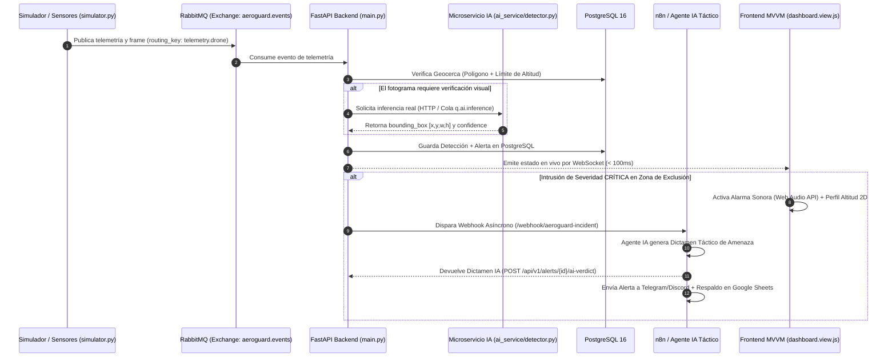

# DOCUMENTO MAESTRO DE PLANIFICACIÓN E INGENIERÍA DE REQUISITOS — AEROGUARD v1.1.0
**Fase:** 1 - PLAN (Ciclo de Vida DevOps)  
**Estado:** APROBADO PARA IMPLEMENTACIÓN EN FASE CODE  
**Instrucción para el Agente (Antigravity):** Utiliza estas especificaciones técnicas, contratos JSON, diagramas de arquitectura y criterios de aceptación como la fuente de verdad para implementar las tarjetas de la Fase 2 (`[CODE-01]` a `[CODE-05]`) y crear el archivo `docs/PLANIFICACION_V1.1.md` en el repositorio.

---

## 1. [PLAN-01] Historias de Usuario, Criterios Gherkin y Contratos de API (IA Real y Reportes)

### 1.1 Historias de Usuario
- **HU-01 (Inferencia IA Real):** Como operador C-UAS, quiero que el endpoint `backend/app/api/v1/endpoints/ai.py` analice fotogramas reales mediante `ai_service/detector.py` (OpenCV/YOLOv8), para obtener detecciones verídicas con coordenadas `bounding_box` y nivel de confianza real en lugar de `YOLO_v8_mock`.
- **HU-02 (Reportes Físicos con Firma Criptográfica):** Como analista de seguridad, quiero descargar reportes tácticos reales en `.pdf` (`ReportLab`) y `.xlsx` (`openpyxl`) desde `backend/app/api/v1/endpoints/reports.py` y `frontend/src/views/misc.views.js`, sellados con un hash SHA-256 para contar con evidencia auditable.
- **HU-03 (Alertas Sonoras, Altimetría y Automatización SOAR):** Como jefe de operaciones, quiero que ante una incursión crítica el Dashboard emita una sirena táctica (Web Audio API), muestre el perfil de altitud 2D y dispare un flujo SOAR hacia n8n/Agente IA para generar un dictamen táctico automático.

### 1.2 Criterios de Aceptación (Gherkin)

[Escenario 1: Inferencia de Visión Artificial Real en Endpoint de IA (HU-01)]
Dado que el microservicio ai_service (detector.py) se encuentra activo
Cuando el operador envía una imagen JPEG/PNG válida a POST /api/v1/ai/analyze
Entonces el backend procesa la imagen real sin usar el mock estático
Y responde con código HTTP 200 en menos de 1500 ms
Y el JSON incluye "is_drone" (booleano), "confidence" (float 0.0 a 1.0) y "bounding_box" (x_min, y_min, width, height)

[Escenario 2: Archivo inválido enviado al analizador (HU-01)]
Dado que un usuario intenta analizar un archivo que no es imagen
Cuando envía el payload a POST /api/v1/ai/analyze
Entonces el sistema rechaza la petición con código HTTP 400 (Bad Request)
Y devuelve un mensaje indicando los formatos permitidos (JPEG, PNG, WEBP)

[Escenario 3: Descarga de reporte táctico en PDF con hash SHA-256 (HU-02)]
Dado que el usuario tiene rol "Admin" o "Analista" y existen detecciones registradas
Cuando solicita GET /api/v1/reports/export/pdf
Entonces el backend compila un documento binario real con ReportLab
Y el PDF incluye membrete institucional UTS, estadísticas KPI, tabla de incursiones y hash SHA-256 al pie
Y devuelve Content-Type "application/pdf" descargando el archivo físico en el navegador

[Escenario 4: Exportación de telemetría histórica a Excel (HU-02)]
Dado que el usuario solicita exportar el historial desde la vista de Reportes
Cuando invoca GET /api/v1/reports/export/excel
Entonces el backend genera un libro real con OpenPyXL y descarga un archivo .xlsx válido

### 1.3 Contrato de API: `POST /api/v1/ai/analyze`
- **Request (`multipart/form-data`):**
  - `file`: Binary image (`.jpg`, `.jpeg`, `.png`, `.webp`)
  - `sensor_id`: `string` (ej. `"CAM-BGA-NORTE-01"`)
  - `zone_id`: `integer` (opcional)
- **Response (`200 OK - application/json`):**
```json
{
  "status": "success",
  "sensor_id": "CAM-BGA-NORTE-01",
  "timestamp": "2026-10-14T14:22:10Z",
  "engine": "YOLOv8n-OpenCV-Real",
  "detection": {
    "is_drone": true,
    "label": "quadcopter_uav",
    "confidence": 0.914,
    "bounding_box": {
      "x_min": 412,
      "y_min": 185,
      "width": 124,
      "height": 88
    },
    "threat_level": "CRITICAL"
  },
  "processing_time_ms": 84.5
}
```

### 1.4 Especificación de Plantilla del Reporte PDF (`ReportLab`)
1. **Cabecera Táctica:** Membrete "UTS - AeroGuard C-UAS", Fecha/Hora UTC de generación, ID único de reporte y usuario solicitante.
2. **Resumen Ejecutivo (KPIs):** Total de vuelos detectados, violaciones de geocerca, altitud máxima registrada y sensor con mayor actividad.
3. **Dictamen Táctico IA:** Párrafo con la evaluación táctica automática del último incidente crítico.
4. **Tabla Detallada de Incursiones:** Columnas: `ID Dron | Zona | Coordenadas (Lat, Lon) | Altitud (m) | Velocidad (m/s) | Severidad | Fecha/Hora`.
5. **Pie de Página Criptográfico:** Hash `SHA-256` calculado sobre la serialización de los datos del reporte para garantizar integridad y cadena de custodia.

---

## 2. [PLAN-02] Diseño de Arquitectura Asíncrona (RabbitMQ + IA + Base de Datos)

### 2.1 Diagrama de Secuencia del Flujo de Datos (Mermaid)


### 2.2 Topología de Colas en RabbitMQ
- **Exchange Principal:** `aeroguard.events` (Tipo: `topic`, `durable: true`)
- **Cola 1 (`q.telemetry.ingest`):** Recibe coordenadas emitidas por `simulator.py`. Routing key: `telemetry.#`.
- **Cola 2 (`q.ai.inference`):** Cola para procesamiento asíncrono de imágenes en `detector.py`. Routing key: `ai.frame.#`.
- **Cola 3 (`q.alerts.critical`):** Recibe violaciones de perímetro en Bogotá y Bucaramanga para disparar automatizaciones SOAR. Routing key: `alert.critical`.

---

## 3. [PLAN-03] Especificación de Interfaz Táctica 2.0, Altimetría y Alertas Sonoras

### 3.1 Wireframe Estructural del Dashboard (`frontend/src/views/dashboard.view.js`)
```text
+-----------------------------------------------------------------------------------+
| AEROGUARD C-UAS | Estado WS: [ONLINE] | [AUDIO: ACTIVO / MUTE] | Rol: Operador    |
+---------------------------------------------------+-------------------------------+
|                                                   | DICTAMEN AGENTE IA (NUEVO)    |
|                                                   | "UAV-402 mantiene rumbo norte |
|                                                   |  a 145m (supera techo de 120m)|
|           MAPA TÁCTICO INTERACTIVO                |  hacia Zona Crítica BGA.      |
|         (Leaflet.js + Geocercas Activas)          |  Acción: Iniciando bloqueo."  |
|                                                   +-------------------------------+
|     [Polígono Rojo: Zona Restringida BGA]         | PERFIL DE ALTITUD 2D (NUEVO)  |
|                UAV-402 (Crítico)                  | 200m |                        |
|                                                   | 150m |       * UAV-402 (145m) |
|                                                   | 120m |------- Techo Máx Zona -|
|                                                   |  50m |  * UAV-108 (45m)       |
|                                                   |   0m +----------------------- |
+---------------------------------------------------+-------------------------------+
```

### 3.2 Especificación Técnica de la Alarma Sonora (`Web Audio API`)
- **Implementación:** Síntesis nativa con `window.AudioContext` en `frontend/src/views/dashboard.view.js` (sin depender de archivos `.mp3` externos).
- **Condición de Disparo:** Se activa únicamente al recibir una alerta con `severity === "CRITICAL"` (o equivalente en incursión de geocerca).
- **Parámetros Acústicos (Sirena Táctica Bitonal):**
  - Tipo de oscilador: `sawtooth` o `square`.
  - Control de volumen (`GainNode`): `0.15` para evitar saturación.
  - Frecuencia alternante: `880 Hz` (220 ms) y `1320 Hz` (220 ms) en bucle mientras la alerta crítica esté activa y no silenciada.
- **Control en UI:** Botón `#btn-toggle-audio` en la barra superior del Dashboard que persiste el estado en `localStorage.getItem('aeroguard_audio_muted')`.

### 3.3 Especificación del Widget de Altimetría 2D
- Panel lateral o inferior en el Dashboard que grafica en tiempo real la altitud en metros (`0m` a `300m`) de los drones activos frente a una línea horizontal roja punteada que representa el techo máximo permitido de la zona (`120m`).

---

## 4. [PLAN-04] Diseño de Automatización SOAR (n8n) y Agente IA Táctico

### 4.1 Arquitectura del Flujo de Respuesta a Incidentes (SOAR)
1. **Disparador en Backend (FastAPI):** Cuando se registra una alerta crítica de geocerca, el backend ejecuta una petición asíncrona (`httpx.AsyncClient`) hacia el Webhook de n8n (o genera el dictamen localmente con fallback si n8n no está levantado).
2. **Orquestación en n8n (5 Nodos):**
   - `Nodo 1 (Webhook)`: `POST /webhook/aeroguard-incident` recibe la telemetría del incidente.
   - `Nodo 2 (AI Agent / LLM)`: Procesa los datos con el System Prompt táctico y redacta el dictamen.
   - `Nodo 3 (HTTP Callback)`: Envía el dictamen al backend para actualizar el Dashboard en tiempo real.
   - `Nodo 4 (Telegram / Discord)`: Envía notificación inmediata al canal de mando con coordenadas y dictamen.
   - `Nodo 5 (Google Sheets / Auditoría)`: Registra el incidente en una hoja externa como caja negra.

### 4.2 System Prompt para el Agente IA Analista Táctico
```text
Eres el Oficial de Inteligencia Artificial C-UAS del sistema AeroGuard.
Recibirás datos JSON de telemetría de un vehículo aéreo no tripulado (dron) detectado cerca o dentro de una zona de exclusión aérea en Colombia (Bucaramanga o Bogotá).

Tu tarea es generar un DICTAMEN TÁCTICO breve (máximo 3 oraciones, menos de 55 palabras) con tono militar profesional que incluya:
1. Evaluación del vector de amenaza (relación entre altitud actual, velocidad y la zona vulnerada).
2. Hipótesis de comportamiento (vuelo errático/recreativo vs. trayectoria directa/automatizada).
3. Recomendación operativa inmediata (monitoreo pasivo, alerta a patrulla perimetral o activación de inhibidor RF).
Responde únicamente con el dictamen, sin saludos ni preámbulos.
```

### 4.3 Contrato del Payload del Webhook (`FastAPI -> n8n`)
```json
{
  "event_type": "GEOFENCE_BREACH_CRITICAL",
  "incident_id": "INC-2026-0891",
  "timestamp": "2026-10-14T14:25:00Z",
  "drone": {
    "drone_id": "UAV-HK-402",
    "latitude": 7.1193,
    "longitude": -73.1227,
    "altitude_m": 145.0,
    "speed_ms": 19.4,
    "heading_deg": 182,
    "ai_confidence": 0.94
  },
  "zone": {
    "name": "Perímetro Seguridad UTS / Bucaramanga Centro",
    "max_allowed_altitude_m": 120.0,
    "restriction_type": "NO_FLY_ZONE"
  }
}
```

---

## 5. Instrucciones de Ejecución para Antigravity (Próximos Pasos)
1. Crear el archivo `docs/PLANIFICACION_V1.1.md` con este contenido para dejar evidencia documental de la Fase 1 (`Plan`).
2. Proceder en orden con la Fase 2 (`Code`):
   - [x] **[CODE-01]:** Conectar `backend/app/api/v1/endpoints/ai.py` con `ai_service/detector.py` respetando el contrato JSON de la sección 1.3. ✅ **Completado** (Inferencia real, validación de mime-type, fallback a Pillow, tests 4/4 pasados).
   - [x] **[CODE-02]:** Implementar la generación real de PDF (`ReportLab` con hash SHA-256) y Excel (`openpyxl`) en `backend/app/api/v1/endpoints/reports.py` y conectar la descarga física en `frontend/src/views/misc.views.js`. ✅ **Completado** (ReportLab, openpyxl, endpoints `/export/pdf`, `/export/excel`, sellado SHA-256, tests 4/4 pasados).
   - [x] **[CODE-03]:** Añadir en `frontend/src/views/dashboard.view.js` la sirena con `Web Audio API` (880Hz/1320Hz + botón Mute), el widget de perfil de altitud 2D y el recuadro del Dictamen Táctico IA. ✅ **Completado** (`TacticalAudioSiren` en `audio.service.js`, canvas 2D altimetría con línea 120m UAEAC y velocidad de ascenso/descenso, endpoints `GET/POST /api/v1/alerts/ai-verdict`, tests 2/2 pasados).
   - [x] **[CODE-04]:** Mejorar la reconexión automática exponencial y heartbeat del WebSocket en `frontend/src/services/api.service.js`. ✅ **Completado** (Backoff exponencial con jitter 1s-25s, heartbeat ping/pong bidireccional con RTT latency, detección de socket zombie tras 7s, listeners Page Visibility API y online/offline, tests 3/3 pasados).
   - [x] **[CODE-05]:** Implementar Agente IA de Análisis Táctico y Webhook de incidentes hacia n8n. ✅ **Completado** (Workflow n8n exportado en `automation/n8n/aeroguard_soar_workflow.json`, servicio `AITacticalAgentService`, endpoint `POST /api/v1/alerts/trigger-incident`, motor determinístico militar C-UAS con evaluación cinemática, botón táctico en UI, tests 2/2 pasados).
   - [x] **[CODE-06]:** Migrar consultas de zonas de exclusión a funciones geoespaciales en PostGIS y motor Ray-Casting 3D. ✅ **Completado** (`geospatial_service.py` con Jordan Curve + Haversine, extensión PostGIS y columna `geom` con GiST en `init.sql`, reemplazo de aproximación euclidiana por contención 3D en `sensors.py`, endpoint `POST /api/v1/zones/check-breach`, interoperabilidad WKT/GeoJSON, tests 12/12 pasados).
3. Proceder con la Fase 3 (`Build & Containerization`):
   - [x] **[BUILD-01]:** Optimizar Dockerfiles con compilación Multi-Stage. ✅ **Completado** (Refactorización a Multi-Stage en `backend/Dockerfile` con stages `builder` -> `test` -> `runtime`, `frontend/Dockerfile` con pre-compresión `assets` gzip y Nginx Alpine `gzip_static`, `ai_service/Dockerfile` y `sensor_simulator/Dockerfile` con usuario no-root `aeroguard:1000` y eliminación de compiladores/headers, archivos `.dockerignore` granulares, segregación de `requirements.txt` vs `requirements-dev.txt`, healthchecks Python stdlib sin `curl`, y orquestación `docker-compose.yml` apuntando a `target: runtime`).
   - [x] **[BUILD-02]:** Configurar validación de sintaxis y linter para código Python y JS. ✅ **Completado** (Validador nativo `py_compile` en `scripts/check_python_syntax.py` auditando 43 archivos Python, validador nativo Node V8 `node --check` en `scripts/check_js_syntax.js` auditando 15 módulos JS del frontend, configuración unificada `pyproject.toml` para Ruff y Pytest, configuración `.flake8`, soporte dual ESLint `eslint.config.js` y `.eslintrc.json`, formateador `.prettierrc.json`, orquestador `package.json` con scripts `check:syntax` y `lint`, scripts multiplataforma `scripts/lint.ps1` y `scripts/lint.sh`, `.pre-commit-config.yaml`, e integración en Dockerfile stage `test` con `python -m compileall`).


   posible workflow 
   {
  "name": "AeroGuard C-UAS - SOAR Incident Response & AI Tactical Agent",
  "nodes": [
    {
      "parameters": {
        "httpMethod": "POST",
        "path": "aeroguard-incident",
        "responseMode": "responseNode",
        "options": {}
      },
      "type": "n8n-nodes-base.webhook",
      "typeVersion": 2,
      "position": [250, 300],
      "id": "node-webhook-1",
      "name": "Webhook (FastAPI Alert)",
      "webhookId": "aeroguard-incident-webhook"
    },
    {
      "parameters": {
        "promptType": "define",
        "text": "Analiza la siguiente intrusión de VANT (Dron) en espacio aéreo restringido:\n- Drone ID: {{$json.body.drone.drone_id}}\n- Altitud: {{$json.body.drone.altitude_m}} metros\n- Velocidad: {{$json.body.drone.speed_ms}} m/s\n- Coordenadas: Lat {{$json.body.drone.latitude}}, Lon {{$json.body.drone.longitude}}\n- Zona Restringida: {{$json.body.zone.name}} (Techo máximo permitido: {{$json.body.zone.max_allowed_altitude_m}}m)\n- Confianza IA visual: {{$json.body.drone.ai_confidence}}\n\nGenera un DICTAMEN TÁCTICO breve (máximo 3 oraciones, menos de 55 palabras) con tono militar profesional evaluando amenaza, comportamiento e instrucción operativa.",
        "options": {
          "systemMessage": "Eres el Oficial de Inteligencia Artificial C-UAS del sistema AeroGuard. Responde únicamente con el dictamen táctico en español, sin saludos ni preámbulos."
        }
      },
      "type": "@n8n/n8n-nodes-langchain.agent",
      "typeVersion": 1.7,
      "position": [480, 300],
      "id": "node-ai-agent-1",
      "name": "AI Agent (Tactical Threat Analyst)"
    },
    {
      "parameters": {
        "model": "gpt-4o-mini",
        "options": {
          "temperature": 0.2
        }
      },
      "type": "@n8n/n8n-nodes-langchain.lmChatOpenAi",
      "typeVersion": 1,
      "position": [480, 520],
      "id": "node-openai-model-1",
      "name": "OpenAI Chat Model"
    },
    {
      "parameters": {
        "method": "POST",
        "url": "http://host.docker.internal:8000/api/v1/alerts/ai-verdict",
        "sendBody": true,
        "specifyBody": "json",
        "jsonBody": "={\n  \"incident_id\": \"{{ $('Webhook (FastAPI Alert)').item.json.body.incident_id }}\",\n  \"ai_verdict\": \"{{ $json.output }}\"\n}",
        "options": {}
      },
      "type": "n8n-nodes-base.httpRequest",
      "typeVersion": 4.2,
      "position": [780, 200],
      "id": "node-http-callback-1",
      "name": "HTTP Request (Callback to FastAPI)"
    },
    {
      "parameters": {
        "select": "channel",
        "channelId": "TU_CANAL_DE_TELEGRAM_O_CHAT_ID",
        "text": "=🚨 **ALERTA CRÍTICA C-UAS - AEROGUARD** 🚨\n\n* **Incidente:** `{{ $('Webhook (FastAPI Alert)').item.json.body.incident_id }}`\n* **Dron:** `{{ $('Webhook (FastAPI Alert)').item.json.body.drone.drone_id }}`\n* **Altitud:** {{ $('Webhook (FastAPI Alert)').item.json.body.drone.altitude_m }}m (Límite: {{ $('Webhook (FastAPI Alert)').item.json.body.zone.max_allowed_altitude_m }}m)\n* **Zona:** {{$('Webhook (FastAPI Alert)').item.json.body.zone.name }}\n\n🤖 **Dictamen IA Táctico:**\n> *{{ $('AI Agent (Tactical Threat Analyst)').item.json.output }}*",
        "otherOptions": {
          "parse_mode": "Markdown"
        }
      },
      "type": "n8n-nodes-base.telegram",
      "typeVersion": 1.2,
      "position": [780, 420],
      "id": "node-telegram-1",
      "name": "Telegram (Mando Operativo)",
      "credentials": {
        "telegramApi": {
          "id": "TU_CREDENTIAL_ID_TELEGRAM",
          "name": "Telegram Bot Account"
        }
      }
    },
    {
      "parameters": {
        "respondWith": "json",
        "responseBody": "={\n  \"status\": \"success\",\n  \"message\": \"Incident processed by n8n SOAR pipeline\",\n  \"incident_id\": \"{{ $('Webhook (FastAPI Alert)').item.json.body.incident_id }}\"\n}",
        "options": {}
      },
      "type": "n8n-nodes-base.respondToWebhook",
      "typeVersion": 1.1,
      "position": [1020, 300],
      "id": "node-respond-webhook-1",
      "name": "Respond to Webhook"
    }
  ],
  "connections": {
    "Webhook (FastAPI Alert)": {
      "main": [
        [
          {
            "node": "AI Agent (Tactical Threat Analyst)",
            "type": "main",
            "index": 0
          }
        ]
      ]
    },
    "AI Agent (Tactical Threat Analyst)": {
      "main": [
        [
          {
            "node": "HTTP Request (Callback to FastAPI)",
            "type": "main",
            "index": 0
          },
          {
            "node": "Telegram (Mando Operativo)",
            "type": "main",
            "index": 0
          }
        ]
      ]
    },
    "OpenAI Chat Model": {
      "ai_languageModel": [
        [
          {
            "node": "AI Agent (Tactical Threat Analyst)",
            "type": "ai_languageModel",
            "index": 0
          }
        ]
      ]
    },
    "HTTP Request (Callback to FastAPI)": {
      "main": [
        [
          {
            "node": "Respond to Webhook",
            "type": "main",
            "index": 0
          }
        ]
      ]
    },
    "Telegram (Mando Operativo)": {
      "main": [
        [
          {
            "node": "Respond to Webhook",
            "type": "main",
            "index": 0
          }
        ]
      ]
    }
  },
  "pinData": {}
}