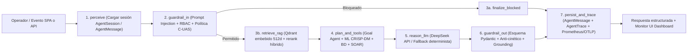

# Arquitectura de Agentes de IA, RAG, Guardrails y LLMOps — AeroGuard C-UAS

Documento de diseño e implementación del **Módulo B (Agentes de IA en Producción)** de AeroGuard, integrado sobre el núcleo táctico existente (PostgreSQL/PostGIS, RabbitMQ, FastAPI, n8n SOAR, `goal_based_agent.py`, `predictive_ml_service.py`) y dimensionado para ejecutarse dentro del presupuesto de **4 GiB RAM / 2 vCPU en Oracle Cloud** (`x86_64` y `ARM64`/`aarch64`).

---

## 1. Fundamento Conceptual: `Agente = LLM + Herramientas + Memoria + Bucle de Decisión`

En AeroGuard un agente no es un chatbot aislado: es un sistema de software acotado por políticas C-UAS y permisos RBAC que combina cuatro pilares verificables:

1. **Motor de Razonamiento (`LLM` + Fallback Determinista):**
   Configurado en `backend/app/core/config.py` y ejecutado en `_node_reason_llm` dentro de `backend/app/services/agent_graph_service.py`. Soporta **DeepSeek API (OpenAI-compatible)** vía `LLM_PROVIDER`, `DEEPSEEK_API_KEY`, `DEEPSEEK_BASE_URL` y `DEEPSEEK_MODEL`, con **fallback determinista local automático** cuando no hay clave de API, en entornos *offline* o en CI.
2. **Herramientas Verificables (`Tools`):**
   Implementadas en `backend/app/services/agent_tools.py` y expuestas también por **MCP JSON-RPC 2.0** (`backend/app/services/mcp_server.py`):
   - `evaluate_goal_agent` (`goal_based_agent.py` -> `evaluate_goals`)
   - `predict_telemetry_ml` (`predictive_ml_service.py` -> Random Forest, Regresión Lineal, Regresión Logística, K-Means)
   - `get_incursion_forecast` (`predictive_ml_service.py` -> ARIMA 14 días)
   - `get_operational_snapshot` (consulta asíncrona SQLAlchemy con verificación RBAC de zonas activas, alertas y sensores)
   - Despacho SOAR opcional (`run_dispatch_soar_tool` -> `ai_tactical_agent_service.py` / webhook n8n)
   - Búsqueda documental vectorial (`search_cuas_knowledge` -> Qdrant RAG)
3. **Memoria Persistente (`Short-term + Long-term`):**
   - **Memoria conversacional / episódica:** tablas ORM `AgentSession` y `AgentMessage` en `backend/app/models/models.py` (PostgreSQL en producción o SQLite en tests/local).
   - **Memoria semántica vectorial (RAG):** colección `aeroguard_cuas_knowledge` gestionada por `AgentRagService` en `backend/app/services/agent_rag_service.py` sobre **Qdrant embebido local** (`qdrant-client`).
4. **Bucle de Decisión Explícito (`StateGraph` en `LangGraph`):**
   Orquestación con estado tipado (`AgentGraphState`) de 8 nodos compilados con `langgraph.graph.StateGraph` (y fallback secuencial idéntico si el wheel opcional no está presente).

---

## 2. Flujo de Producción End-to-End

Alineado con arquitectura segura en producción:
`Operador / Evento -> Guardrail de Entrada -> Agente (LangGraph) -> Guardrail de Salida -> Respuesta / Acción`

---

## 3. Comparativa de Frameworks de Orquestación

| Criterio | **LangGraph (Adoptado)** | **LangChain (Chains)** | **CrewAI** | **AutoGen** | **LlamaIndex** |
| --- | --- | --- | --- | --- | --- |
| **Control de flujo y estado** | Grafo explícito con estado tipado (`AgentGraphState`) y aristas condicionales auditables | Cadenas lineales/DAG menos flexibles ante ramificación de Guardrails | Basado en roles y tareas implícitas entre agentes | Conversación multi-agente emergente menos predecible en latencia | Excelente en pipelines RAG; orquestación agéntica secundaria |
| **Auditoria y seguridad C-UAS** | Determinista por nodo (`guardrail_in -> finalize_blocked / retrieve_rag`) | Media; trazas dispersas en callbacks | Baja previsibilidad de llamadas exactas | Riesgo de bucles conversacionales largos | Media; orientado a consulta de índices |
| **Huella RAM (Oracle 4 GiB)** | Muy baja (`langgraph` + `langchain-core` puro sin runtimes pesados) | Baja-Media según integraciones | Media-Alta al instanciar múltiples *crews* | Alta si mantiene múltiples historiales LLM | Media |
| **Decisión en AeroGuard** | **Seleccionado** (`backend/requirements-agent.txt`, `agent_graph_service.py`) | Usamos únicamente primitivas livianas de `langchain-core` | Descartado para runtime crítico | Descartado por latencia/costo de tokens | Descartado; RAG cubierto directo con `qdrant-client` |

---

## 4. Memoria, Embeddings Livianos y RAG Vectorial (Comparativa Vector DBs)

### 4.1 Comparativa de Bases Vectoriales

| Motor Vectorial | **Qdrant (Adoptado)** | **Pinecone** | **Weaviate** |
| --- | --- | --- | --- |
| **Modo sin contenedor extra** | **Sí:** `qdrant-client` embebido persistente sobre volumen (`QDRANT_PATH`) | No (SaaS exclusivamente gestionado en la nube) | Experimental embebido; foco principal en servidor |
| **Escalado a servidor dedicado** | Transparente cambiando `QDRANT_URL` (`--profile qdrant-external`) | Escala en la nube con latencia de red externa | Contenedor Go/JVM pesado para instancias 4 GiB |
| **Privacidad / Red interna Oracle** | 100% local dentro de red privada Docker (`internal: true`) | Datos salen a terceros por API | Local, pero mayor consumo de memoria base |
| **Decisión en AeroGuard** | **Seleccionado** (`agent_rag_service.py`) | Descartado por dependencia cloud obligatoria | Descartado por presupuesto RAM Oracle |

### 4.2 Estrategia de Embeddings Livianos y Corpus C-UAS (`0 torch`)

Para cumplir la restricción estricta de memoria en Oracle (`<= 4 GiB RAM`) y compatibilidad inmediata `x86_64` / `ARM64`, AeroGuard **no instala `torch` ni `sentence-transformers`**. En su lugar, `LightweightEmbedder` (`backend/app/services/agent_rag_service.py`) calcula vectores normalizados de **`512` dimensiones** en NumPy (feature hashing con deduplicación de tokens, bigramas, n-gramas acotados, expansión de sinónimos C-UAS y énfasis de títulos de sección), combinado con `_hybrid_rerank_score` sobre los candidatos devueltos por `QdrantClient.query_points()` y soporte opcional para embeddings remotos vía `EMBEDDING_API_URL`.

El corpus inicial vive en `docs/conocimiento_cuas/`:
- `01_protocolos_operativos_cuas.md` — Cota 120 m AGL, reglas de detección, escalamiento y prohibición cinética/jamming.
- `02_reglas_geocercas_colombia.md` — Zonas críticas aeroportuarias y complejos gubernamentales en Colombia.
- `03_conocimiento_crisp_dm_ml.md` — Interpretación de los 6 modelos CRISP-DM (`Random Forest`, `Regresión Lineal`, `Regresión Logística`, `K-Means`, `Árbol de Decisión`, `ARIMA`).
- `04_guia_operacion_aeroguard.md` — RBAC (`admin`, `operator`, `analyst`), monitoreo y operación segura.

---

## 5. Guardrails de Entrada y Salida (Comparativa)

| Enfoque | Latencia adicional | Dependencias / RAM | Cobertura en AeroGuard |
| --- | --- | --- | --- |
| **Guardrails AI** | Media (validators + reintentos LLM) | Alta si descarga modelos Hub | Inspira el contrato tipado de salida |
| **NeMo Guardrails** | Alta (doble llamada LLM Colang) | Media-Alta | Innecesario frente a políticas deterministas C-UAS |
| **Pydantic v2 + Reglas C-UAS (`agent_guardrails.py`, Adoptado)** | **< 2 ms determinista** | **Cero dependencias extra** | **Seleccionado:** Entrada + Salida + RBAC + Grounding |

Controles implementados en `backend/app/services/agent_guardrails.py`:
- **`evaluate_input_guardrail` (Entrada):** detecta *prompt injection* (`ignora instrucciones`, `system prompt`, `jailbreak`, XSS/SQLi), fuga de secretos (`password_hash`, `secret_key`, `metrics_bearer_token`), operaciones fuera de política (`ransomware`, explosivos) y violaciones **RBAC** (`alerts:dispatch`, `users:read`, `zones:write`) según el rol JWT del usuario.
- **`evaluate_output_guardrail` (Salida):** valida el esquema estricto **`AgentStructuredOutput`** (Pydantic v2), bloquea cualquier sugerencia cinética/ilegal no autorizada (`jamming`, `spoofing`, `derribo`, `hackear dron`), filtra accidentalmente secretos/hashes, exige `human_review_required = True` y verifica *grounding* (`grounding_verified`) contra herramientas ejecutadas y fragmentos RAG reales.

---

## 6. Interoperabilidad, Mensajería, Orquestación Batch y LLMOps

### 6.1 Interoperabilidad: API REST + MCP (`JSON-RPC 2.0`)
- **API REST v1 (`/api/v1/agent`):**
  - `POST /api/v1/agent/query` — Ejecuta el grafo LangGraph completo.
  - `GET /api/v1/agent/sessions` y `GET /api/v1/agent/sessions/{session_id}` — Historial persistente por usuario/sesión.
  - `GET /api/v1/agent/traces` — Trazas LLMOps con latencias por nodo.
  - `GET /api/v1/agent/llmops/summary` — Conteo agregado de ejecuciones, bloqueos y estado Qdrant.
  - `POST /api/v1/agent/rag/reindex` — Re-indexación manual (`config:write`).
- **MCP (`POST /api/v1/agent/mcp`, `backend/app/services/mcp_server.py`):** Implementa `initialize`, `tools/list` y `tools/call` bajo `MCP_PROTOCOL_VERSION = "2024-11-05"` reutilizando exactamente las mismas 5 herramientas verificables y controles RBAC.

### 6.2 Mensajería y Programación de Tareas
- **RabbitMQ vs Apache Kafka:** AeroGuard mantiene **RabbitMQ** (`rabbitmq:4.3.6-management-alpine`, `384 MiB` RAM en Oracle) ya integrado en `compose.yml` para colas AMQP de alertas/detecciones; Apache Kafka + ZooKeeper/KRaft excedería sin necesidad el presupuesto de 4 GiB RAM para el volumen de telemetría actual.
- **APScheduler + n8n vs Apache Airflow:** `rag_scheduler_service.py` reutiliza **`APScheduler`** (junto a `report_scheduler_service.py`) para reindexar el corpus RAG cada `RAG_REINDEX_INTERVAL_MINUTES` (60 min por defecto) en segundo plano sin levantar workers/scheduler de Airflow; **n8n** permanece desacoplado vía webhook (`N8N_WEBHOOK_URL`) para automatización SOAR.

### 6.3 Observabilidad LLMOps
Implementada en `backend/app/services/agent_llmops.py`:
- **Persistencia en BD:** tabla `agent_traces` (`AgentTrace` en `models.py`) guardando `provider`, `engine`, `guardrail_in_passed`, `guardrail_out_passed`, `blocked_reason`, `rag_hits`, `tools_called`, `node_latencies_ms`, `total_latency_ms` y `estimated_tokens`.
- **Prometheus (`/metrics` protegido por bearer token):**
  - `aeroguard_agent_requests_total` (`provider`, `status`)
  - `aeroguard_agent_latency_seconds` (`provider`)
  - `aeroguard_agent_guardrail_blocks_total` (`stage`, `reason`)
  - `aeroguard_agent_rag_hits_total`
  - `aeroguard_agent_tokens_estimated_total` (`provider`)
- **Alertas y Paneles (`monitoring/rules.yml` y `monitoring/grafana/dashboard.json`):** reglas `AeroGuardAgentHighGuardrailBlocks` y `AeroGuardAgentHighLatency`, y 3 paneles dedicados (`id: 5, 6, 7`) en Grafana.
- **Exportadores externos opcionales:** soporte no bloqueante hacia **LangSmith** (`LANGSMITH_TRACING` / `LANGSMITH_API_KEY`) u **OpenTelemetry OTLP** (`OTEL_EXPORTER_OTLP_ENDPOINT`), elegidos frente a **Arize Phoenix** por evitar otro contenedor servidor en Oracle 4 GiB RAM.

---

## 7. Las 7 Propiedades del Agente de Software en AeroGuard

| Propiedad | Materialización en AeroGuard |
| --- | --- |
| **1. Autonomía acotada** | Ejecuta percepción, RAG, herramientas y síntesis sin intervención manual en cada paso, acotado por Guardrails y `human_review_required=True`. |
| **2. Reactividad** | Reacciona ante consultas del operador y contexto telemétrico/alerta en `POST /api/v1/agent/query` o eventos del dashboard. |
| **3. Proactividad** | `rag_scheduler_service.py` actualiza periódicamente el conocimiento vectorial; `plan_and_tools` consulta pronóstico ARIMA y alertas abiertas sin esperar a que el usuario las pida explícitamente. |
| **4. Habilidad social / Interoperabilidad** | Expone contratos REST estructurados, interfaz UI segura (`AgentService` + `#agent-monitor-result`) y protocolo estándar **MCP JSON-RPC 2.0**. |
| **5. Persistencia y memoria** | Sesiones/mensajes (`AgentSession`, `AgentMessage`), trazas (`AgentTrace`) y colección Qdrant persistida en volumen (`qdrant_data`). |
| **6. Adaptabilidad** | Selección dinámica de herramientas según contexto (`telemetry`, `zone`, `query`), fallback automático DeepSeek -> determinista y actualización continua del corpus Markdown C-UAS. |
| **7. Racionalidad y verificabilidad** | Las recomendaciones se apoyan en citas RAG trazables (`rag_citations`) y dictámenes deterministas/ML reales (`goal_based_agent`, `predictive_ml_service`), nunca inventando acciones cinéticas ilegales. |

---

## 8. Taxonomía Completa de los 9 Tipos de Agentes de IA en AeroGuard

| # | Tipo de Agente | Relación directa con AeroGuard |
| --- | --- | --- |
| 1 | **Reactivo simple** | Reglas inmediatas de umbral en sensores/alertas y filtros regex deterministas del Guardrail de Entrada (`evaluate_input_guardrail`). |
| 2 | **Reactivo basado en modelo** | Seguimiento de estado espacial y trayectoria temporal (`SensorTrack`, distancia a polígono PostGIS y detección de cambios de altitud/rumbo). |
| 3 | **Basado en objetivos** | **`goal_based_agent.py`** (`evaluate_goals`), mantenido intacto y conectado como herramienta verificable `evaluate_goal_agent`. |
| 4 | **Basado en utilidad** | **`predictive_ml_service.py`** ponderando `risk_score` continuo (`Regresión Lineal`), probabilidad de violación (`Regresión Logística`), severidad (`Random Forest`) y perfil K-Means. |
| 5 | **Que aprende** | Pipeline CRISP-DM (`data_mining/05_predictive_models_benchmark.py` con artefactos versionados) + actualización continua de la base de conocimiento vectorizada (`reindex_corpus`). |
| 6 | **Basado en conocimiento (RAG)** | **`agent_rag_service.py`** con Qdrant embebido + 4 documentos C-UAS + reranking híbrido y citas verificables. |
| 7 | **Jerárquico / Orquestador** | **`agent_graph_service.py`** (`StateGraph` de LangGraph) que coordina guardrails, recuperación documental, herramientas analíticas y síntesis LLM. |
| 8 | **Multiagente cooperativo** | Cooperación desacoplada entre el agente orquestador LangGraph, el motor táctico SOAR (`ai_tactical_agent_service.py`), el agente de objetivos (`goal_based_agent.py`) y los trabajadores `ai-worker` / n8n. |
| 9 | **Híbrido neuro-simbólico** | **Arquitectura global adoptada por AeroGuard:** combina razonamiento neuronal/estadístico (DeepSeek LLM + Random Forest/ARIMA) con lógica simbólica determinista (`evaluate_goals`, RBAC, regex C-UAS y esquema Pydantic v2). |

---

## 9. Monitor en Frontend y Despliegue Oracle Cloud

- **Interfaz SPA:** `frontend/src/views/dashboard.view.js`, `frontend/src/viewmodels/dashboard.viewmodel.js` (`_renderAgentMonitor()` y botón `#btn-agent-query`) y `frontend/src/services/api.service.js` (`AgentService`) muestran decisión recomendada, prioridad, latencia/tokens LLMOps, estado del Guardrail (`GUARDRAIL OK` / `BLOQUEADO IN` / `BLOQUEADO OUT`), herramientas invocadas y citas RAG renderizadas de forma segura (`textContent` sin `innerHTML`).
- **Despliegue Oracle Cloud:** detallado paso a paso en [`deploy/compose.oracle.yml`](../deploy/compose.oracle.yml) y [`deploy/ORACLE_CLOUD.md`](../deploy/ORACLE_CLOUD.md) (`2304 MiB` base / `2816 MiB` con Prometheus + Grafana bajo el límite de `4 GiB RAM / 2 vCPU`).
