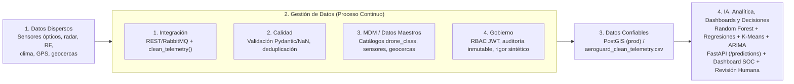
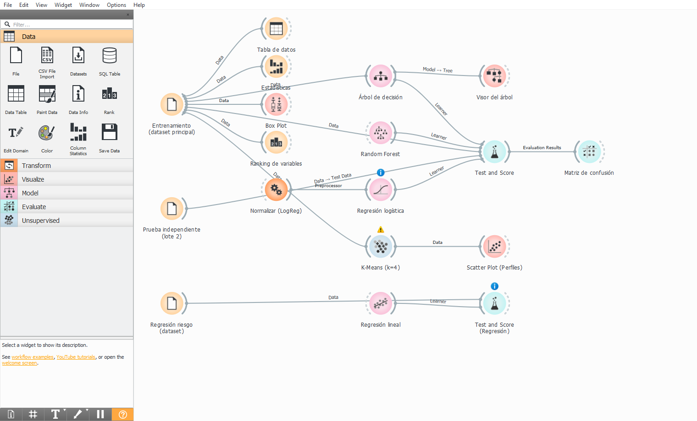
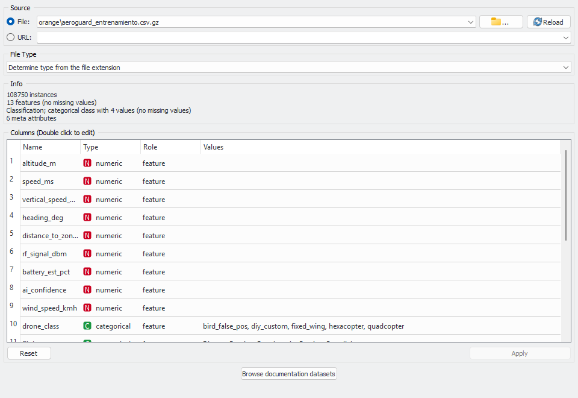
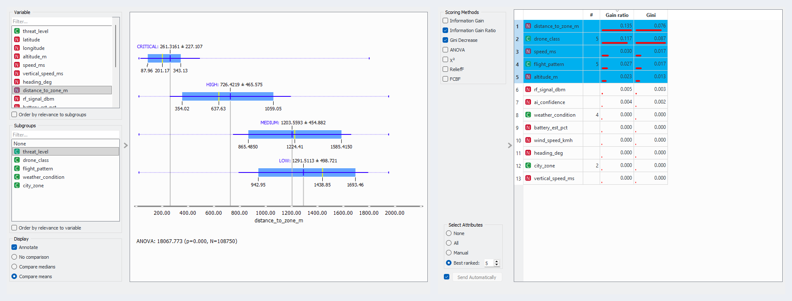
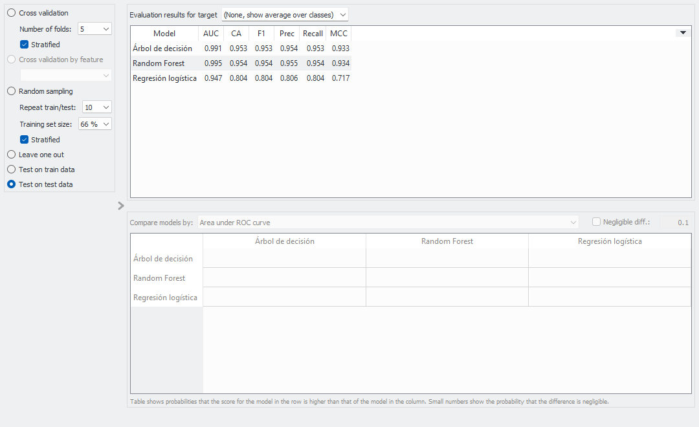
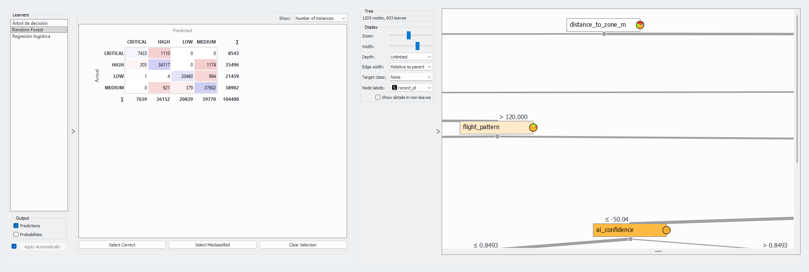
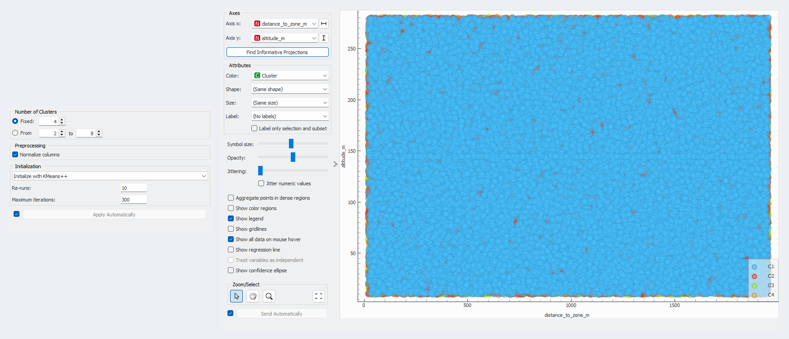
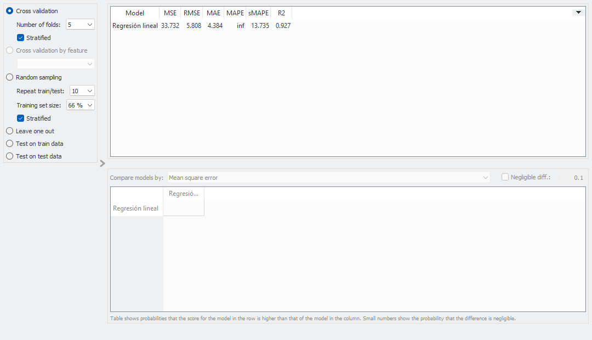

# Minería de Datos Predictiva, Transformación de Datos y Madurez IA (CRISP-DM) — AeroGuard C-UAS

**Sistema de Monitoreo y Analítica Táctica contra Aeronaves No Tripuladas**  
**Rama / Versión de referencia:** `1.2.0-rc.2` + Módulo Predictivo (`feat/juan`)  
**Volumen auditado:** 125,000 registros brutos $\rightarrow$ **108,750 limpios** (principal) | 120,000 brutos $\rightarrow$ **104,400 limpios** (Lote 2 independiente)

> **Advertencia de rigor científico:** Los datasets de este módulo son **sintéticos** (`threat_level` y `risk_score` derivan de reglas cinemáticas del generador). Las métricas obtenidas (Accuracy > 95 %, $R^2 = 0.9356$, AUC $= 0.9689$, MAPE $= 6.77\%$) comprueban consistencia matemática y recuperación de patrones en un entorno controlado; **no constituyen evidencia de desempeño con drones o sensores físicos reales**. Toda recomendación generada en la plataforma exige verificación humana.

---

## 1. Enfoque Predictivo y Fase 1: Comprensión del Negocio (CRISP-DM)

A diferencia de la estadística puramente descriptiva (promedios o conteos históricos), AeroGuard implementa **minería de datos predictiva** para anticipar eventos, probabilidades de riesgo y tendencias operativas mediante preguntas de negocio concretas:

1. **¿Cuál es el nivel de amenaza táctica (`threat_level`)** de un vector aéreo recién detectado dadas sus variables multi-sensor?
2. **¿Cuál es su puntaje continuo de riesgo cinemático (`risk_score`, escala 0–100)** para priorizar colas de atención en el SOC?
3. **¿Cuál es la probabilidad de que el contacto constituya alto riesgo o violación de geocerca** y qué umbral minimiza falsas alarmas sin omitir incursiones?
4. **¿Qué perfiles de vuelo recurrentes** existen en el espacio aéreo sin necesidad de etiquetas previas?
5. **¿Cuántos picos diarios de incursiones `HIGH`/`CRITICAL`** se esperan en las próximas dos semanas para planificar cobertura de operadores?

---

## 2. Fase 2: Comprensión e Identificación de los Datos

### 2.1 Diccionario de Datos (20 Atributos Base + Variable Continua Derivada)

| N° | Variable | Tipo | Rango / Valores | Rol Analítico y Significado C-UAS |
| :---: | :--- | :---: | :---: | :--- |
| **1** | `record_id` | String | `REC-000001`... | Identificador único de trama (metadato, excluido del entrenamiento). |
| **2** | `timestamp` | DateTime | `2026-01-01` a `2026-10-31` | Estampa temporal UTC; base de agregación diaria para la serie ARIMA. |
| **3** | `drone_id` | String | `UAV-HK-xxx`, `UAV-COL-xxx` | Matrícula / firma reportada del vector aéreo (metadato). |
| **4** | `sensor_id` | String | 5 sensores BGA/BOG | Estación receptora (`CAM-BGA-NORTE-01`, `RAD-BGA-SUR-02`, etc.). |
| **5** | `city_zone` | Categórico | `Bucaramanga`, `Bogota` | Jurisdicción geográfica protegida (feature categórica). |
| **6** | `latitude` | Float | ~7.119 (BGA) / ~4.609 (BOG) | Coordenada geodésica de latitud (metadato en modelos ML). |
| **7** | `longitude` | Float | ~-73.122 (BGA) / ~-74.081 (BOG) | Coordenada geodésica de longitud (metadato en modelos ML). |
| **8** | `altitude_m` | Float | 10.0 a 280.0 m (nominal) | Altura AGL observada; referencia normativa civil: 120 m. |
| **9** | `speed_ms` | Float | 0.5 a 32.0 m/s (nominal) | Velocidad horizontal estimada del objetivo. |
| **10** | `vertical_speed_ms` | Float | -8.0 a 12.0 m/s | Tasa de ascenso o descenso vertical. |
| **11** | `heading_deg` | Float | 0.0° a 359.9° | Rumbo magnético del desplazamiento. |
| **12** | `distance_to_zone_m` | Float | 20.0 a 1950.0 m | Distancia radial al centro de la zona restringida protegida. |
| **13** | `rf_signal_dbm` | Float | -105.0 a -35.0 dBm | Potencia RSSI del enlace radioeléctrico de control (RF). |
| **14** | `battery_est_pct` | Float | 8.0 % a 99.0 % | Autonomía residual estimada de la aeronave. |
| **15** | `ai_confidence` | Float | 0.45 a 0.98 | Confianza visual declarada (no calibrada) del detector. |
| **16** | `drone_class` | Categórico | 5 clases | `quadcopter`, `fixed_wing`, `hexacopter`, `diy_custom`, `bird_false_pos`. |
| **17** | `weather_condition` | Categórico | 4 condiciones | `Despejado`, `Nublado`, `Lluvia`, `Niebla`. |
| **18** | `wind_speed_kmh` | Float | 3.0 a 42.0 km/h | Velocidad del viento en la zona de observación. |
| **19** | `flight_pattern` | Categórico | 5 patrones | `Directo`, `Erratico`, `Estacionario`, `Patrullaje`, `Evasivo`. |
| **20** | `threat_level` | Categórico | `LOW`, `MEDIUM`, `HIGH`, `CRITICAL` | **Target multiclase** (clasificación supervisada). |
| **21** | `risk_score` *(derivado)* | Float | 0.0 a 100.0 | **Target continuo** para Regresión Lineal (`compute_risk_score`, sin usar `threat_level`). |

### 2.2 Escala y Calidad Inyectada (80 % / 10 % / 10 %)
Generar **125,000 tramas** garantiza suficiente soporte estadístico para la clase minoritaria `CRITICAL` (~8.2 % del dataset limpio, `8,909` casos) y permite validar contra un segundo lote independiente (`aeroguard_lote_adicional_120000.csv`). La distribución de calidad bruta es:
- **80 % Nominal (100,000 filas):** Telemetría físicamente coherente.
- **10 % Outliers Extremos (12,500 filas):** Altitudes entre 3,500–9,000 m o negativas, velocidades supersónicas (300–650 m/s), distancias > 150 km y vientos > 250 km/h (`01_boxplot_outliers_antes.png`).
- **10 % Datos Sucios (12,500 filas):** 3.5 % nulos, 3.5 % valores corruptos/fuera de escala (`SENSOR_ERR`, `???`, `ai_confidence = 2.45`, `battery_est_pct = 320%`) y **3.0 % duplicados exactos (3,750 filas)** (`02_mapa_nulos_y_calidad.png`).

---

## 3. Fase 3: Preparación y Control de *Data Leakage*

La limpieza unificada reside en `data_mining/limpieza.py` (`clean_telemetry()`), garantizando reglas idénticas entre el pipeline scikit-learn (`02_crisp_dm_pipeline.py`), el benchmark de 6 modelos (`05_predictive_models_benchmark.py`) y los archivos exportados a Orange (`03_export_orange.py`):

1. **Deduplicación exacta:** Eliminación de **3,750 filas duplicadas** (3.00 %), dejando 121,250 registros únicos.
2. **Normalización y rangos acotados:** Conversión de tokens corruptos (`1,096` celdas en el principal) y valores imposibles en confianza, batería o rumbo a `NaN`.
3. **Filtrado de anomalías físicas extremas:** Remoción de **12,500 filas** fuera de envolvente física C-UAS, conservando exactamente **108,750 registros válidos** (Lote 2: 120,000 $\rightarrow$ **104,400 válidos**).
4. **Imputación robusta:** Mediana para variables numéricas y moda para categóricas (`8,750` nulos imputados).
5. **Control estricto de fuga de datos (*Zero Data Leakage*):** A diferencia de la primera iteración del repositorio, ahora **la partición estratificada 80 % entrenamiento (87,000) / 20 % prueba (21,750) se ejecuta ANTES** de ajustar cualquier `StandardScaler`, `OrdinalEncoder` u `OneHotEncoder` mediante `ColumnTransformer` + `Pipeline`. El conjunto de prueba y el Lote 2 permanecen estrictamente ciegos durante el ajuste de parámetros.

---

## 4. Fases 4 y 5: Evaluación Comparativa de los 6 Modelos Obligatorios

El script reproducible [`data_mining/05_predictive_models_benchmark.py`](../data_mining/05_predictive_models_benchmark.py) entrena y evalúa los seis algoritmos requeridos sobre el conjunto limpio (108,750 registros) y valida la generalización frente al Lote 2 independiente (104,400 registros). Los resultados exactos quedan persistidos en `data_mining/reports/comparativa_6_modelos.json`:

| N° | Algoritmo | Pregunta Predictiva en AeroGuard | Métricas Test Interno (20 %, n=21,750) | Métricas Lote 2 Independiente (n=104,400) | Rol y Decisión en AeroGuard |
| :---: | :--- | :--- | :--- | :--- | :--- |
| **1** | **Regresión Lineal** (`LinearRegression`) | ¿Cuál es el puntaje continuo de riesgo cinemático `risk_score` (0–100)? | **$R^2 = 0.9356$** · MAE $= 4.24$ · RMSE $= 5.49$ | **$R^2 = 0.9350$** · MAE $= 4.21$ · RMSE $= 5.47$ | **Integrado en API/UI** para ordenar prioridades en un continuo 0–100. |
| **2** | **Regresión Logística** (`LogisticRegression`) | ¿Cuál es la probabilidad de alto riesgo / violación de geocerca y qué umbral optimiza el F1? | **ROC-AUC $= 0.9689$** · Umbral óptimo $= 0.40$ · **F1 $= 0.8821$** · Prec $= 0.8565$ · Rec $= 0.9094$ · Brier $= 0.0702$ *(Baseline 4 clases: Acc $= 80.64\%$)* | **ROC-AUC $= 0.9691$** · **F1 $= 0.8820$** *(Baseline 4 clases: $80.42\%$)* | **Integrado en API/UI** como calibrador de probabilidad (`high_risk_flag` con umbral $0.40$). Descartado como clasificador de 4 clases frente a árboles ($80.6\%$ vs $95.9\%$). |
| **3** | **K-Means** (`k=4` sobre distancia, altitud y velocidad) | ¿Qué perfiles operativos de vuelo emergen sin etiquetas previas? | **Inercia $= 124,517.6$** · **Silhouette $= 0.2623$** (pico de cohesión en $k=4$ respecto a $k=2..3$; evalúa 4 perfiles físicos claros) | Aplicado por centroides físicos sobre telemetría entrante | **Integrado en API/UI** para etiquetar automáticamente el perfil cinemático del contacto. |
| **4** | **Árbol de Decisión** (`DecisionTreeClassifier`, `depth=12`) | ¿Qué reglas jerárquicas auditables clasifican `threat_level`? | **Accuracy $= 94.23\%$** · F1(W) $= 0.9422$ · F1(Macro) $= 0.9376$ | **Accuracy $= 94.17\%$** · F1(W) $= 0.9417$ | **Modelo secundario explicable** para auditoría visual y sustentación en Orange (*Tree Viewer*). |
| **5** | **Random Forest** (`RandomForestClassifier`, 100 árboles / 12 árboles runtime) | ¿Qué ensamble logra la clasificación multiclase de `threat_level` más estable? | **Completo (100):** **Acc $= 95.95\%$ · F1 $= 0.9595$ · Macro $= 0.9570$**<br>**Runtime (12):** **Acc $= 95.08\%$ · F1 $= 0.9507$** (-0.88 pp) | **Completo:** **95.95%**<br>**Runtime (12):** **95.19%** | **SELECCIONADO A PRODUCCIÓN:** Mejor precisión/estabilidad. Su versión compacta de 12 árboles cabe en **862.4 KB JSON** con **100.00 % de paridad** frente a scikit-learn. |
| **6** | **ARIMA** (`ARIMA(1, 1, 1)`, serie diaria) | ¿Cuántas incursiones diarias `HIGH`/`CRITICAL` se esperan en los próximos 14 días? | Split cronológico 80/20 (243d / 61d): **AIC $= 1897.79$** · **MAE $= 10.09$** · **RMSE $= 12.90$** · **MAPE $= 6.77\%$** | Horizonte futuro 14d: pico esperado `~151.77` eventos/día (`IC 95%: 128.02–175.51`) | **Integrado en API/UI** (`/api/v1/predictions/forecast`) para visualización de tendencia y picos de carga. |

### 4.1 Perfiles Descubiertos por K-Means ($k=4$)

| Clúster | Etiqueta Táctica Asignada | Distancia Media | Altitud Media | Velocidad Media | % Eventos `HIGH`/`CRITICAL` | Participación |
| :---: | :--- | :---: | :---: | :---: | :---: | :---: |
| **C3** | Aproximación Cercana al Perímetro | 469.9 m | 157.6 m | 8.8 m/s | **57.81 %** | 25.67 % |
| **C1** | Sobrevuelo Elevado (Sobre Cota 120 m) | 1,067.3 m | 217.6 m | 23.7 m/s | **61.52 %** | 24.45 % |
| **C0** | Tránsito Rápido Perimetral | 879.8 m | 72.2 m | 23.5 m/s | 43.57 % | 24.64 % |
| **C2** | Vuelo Distante / Baja Energía | 1,515.6 m | 132.1 m | 9.0 m/s | **6.78 %** | 25.24 % |

> **Nota sobre K-Means:** Al incluir las 7 variables originales donde atributos como `battery_est_pct`, `heading_deg` o `vertical_speed_ms` seguían distribuciones uniformes independientes, el Silhouette bajaba a `0.0938`. Restringir K-Means a las 3 variables cinemáticas estructurales (`distance_to_zone_m`, `altitude_m`, `speed_ms`) casi triplicó la cohesión (**Silhouette $= 0.2623$**) y produjo centroides tácticos interpretables.

### 4.2 Justificación de Despliegue para el Servidor Oracle (4 GiB RAM / 2 vCPU)

1. **Por qué Random Forest (12 árboles compacto) pasa a producción como clasificador principal:** Supera ampliamente al modelo lineal multiclase (`95.08 %` vs `80.64 %` en Regresión Logística 4 clases, **+14.44 puntos**), porque el riesgo C-UAS depende de umbrales no lineales combinados (altitud > 120 m $\land$ distancia < 150 m $\land$ clase/patrón). Además, frente al Árbol individual (`94.23 %`), el ensamble reduce la varianza ante lecturas ruidosas (`+0.85 pp` a `1.72 pp`).
2. **Despliegue Cero-Dependencias (*Zero-Bloat*) en `backend/Dockerfile`:** Para no añadir `scikit-learn`, `scipy` ni `statsmodels` a la imagen productiva ni consumir memoria extra en el servidor de **Oracle (4 GiB RAM, compatible `x86_64` y `ARM64`)**, el script exporta los 12 árboles, los vectores de Regresión Lineal/Logística, los centroides de K-Means y el pronóstico ARIMA en un único archivo liviano ([`backend/app/data/predictive_models_artifact.json`](../backend/app/data/predictive_models_artifact.json), **862.4 KB**). El servicio [`predictive_ml_service.py`](../backend/app/services/predictive_ml_service.py) ejecuta la inferencia en **< 2 ms** usando únicamente Python estándar y `numpy`.

### 4.3 Evidencias Gráficas Generadas (`data_mining/reports/figures/`)
1. `01_boxplot_outliers_antes.png` — Detección de anomalías extremas antes de limpiar.
2. `02_mapa_nulos_y_calidad.png` — Cuantificación de nulos, corruptos y duplicados.
3. `03_boxplot_limpio_despues.png` — Distribución física tras `clean_telemetry()`.
4. `04_matriz_correlacion.png` — Correlaciones de Pearson entre telemetría y amenaza.
5. `05_matriz_confusion.png` — Matriz normalizada del clasificador de amenazas.
6. `06_importancia_variables_feature_importance.png` — Ranking de ganancia de información (Gini).
7. `07_regresion_lineal_y_logistica.png` — Dispersión Real vs Predicho de `risk_score` y curva ROC.
8. `08_kmeans_codo_y_perfiles.png` — Curva del codo ($k=2..8$), Silhouette y tasa de riesgo por perfil.
9. `09_arima_pronostico_incursiones.png` — Serie temporal diaria, test cronológico e intervalos de pronóstico a 14 días.
10. `10_comparativa_6_modelos_resumen.png` — Resumen visual comparativo frente a la meta del 92 %.

### 4.4 Reglas de Conocimiento Calculadas (Fase 6)
Calculadas dinámicamente en `data_mining/reports/reglas_conocimiento.json` sobre los 108,750 registros limpios:
1. **Proximidad y velocidad:** Con `distance_to_zone_m < 150 m`, `speed_ms > 20 m/s` y patrón `Directo` o `Evasivo`, el **87.8 %** de los 1,237 eventos resulta `CRITICAL` (base general: `8.2 %`).
2. **Techo de 120 m AGL y drones no comerciales:** Con altitud `> 120 m` y clase `diy_custom` o `fixed_wing`, los niveles `HIGH`/`CRITICAL` alcanzan **69.9 %** frente a `35.8 %` en el resto (`+34.1 pp`, `n = 20,747`).
3. **Descarte de aves (`bird_false_pos`):** El **100.0 %** de `8,761` registros de aves corresponde a `LOW` (regla de filtrado de falsos positivos).
4. **Potencia RF:** Con señal `> -50 dBm`, la proporción `HIGH`/`CRITICAL` sube a **53.2 %** frente a `39.4 %` (`n = 23,217`).

---

## 5. Transformación de Datos Aplicada a AeroGuard

**Principio rector:** *"Transformar datos en decisiones es un proceso, no un evento."* En AeroGuard, el dato bruto de un sensor no produce automáticamente decisiones tácticas confiables; atraviesa cuatro etapas arquitectónicas conectadas:



| Etapa de la Cadena | Aplicación Concreta en AeroGuard | Evidencia en el Repositorio |
| :--- | :--- | :--- |
| **1. Datos Dispersos** | Tramas heterogéneas de sensores ópticos/YOLO (`ai_service`), espectro RF, radar cinemático, climatología y polígonos restringidos; expuestas en crudo a pérdida de paquetes, duplicados y unidades inconsistentes. | `sensor_simulator/`, `01_generate_dataset.py` (`125,000` registros brutos). |
| **2. Gestión — Pilar 1: Integración** | Unificación en esquemas comunes vía API FastAPI, colas AMQP en RabbitMQ 3.13 y módulo compartido de preprocesamiento tabular/Orange. | `backend/app/api/v1/endpoints/sensors.py`, `data_mining/limpieza.py`. |
| **2. Gestión — Pilar 2: Calidad** | Rechazo estricto de `NaN`/`Infinity` y rangos físicos imposibles en HTTP 422 (`StrictJsonRoute` / `ConfigDict`), deduplicación (3,750 filas), limpieza de tokens corruptos e imputación controlada sin *data leakage*. | `backend/app/api/v1/endpoints/predictions.py`, `data_mining/02_crisp_dm_pipeline.py`. |
| **2. Gestión — Pilar 3: MDM (Datos Maestros)** | Estandarización de entidades maestras unívocas: taxonomía oficial de `drone_class`, `flight_pattern`, catálogo de `sensor_id`, zonas restringidas con geometría PostGIS y roles de usuario. | `backend/app/models/models.py`, `data_mining/03_export_orange.py`. |
| **2. Gestión — Pilar 4: Gobierno** | Control de acceso por permisos (`alerts:read`/`write`), registro de auditoría con cadena verificable en reportes, redacción de secretos en logs Nginx/FastAPI y separación explícita entre simulación académica y operación real. | `backend/app/core/security.py`, `audit_service.py`, `docs/MINERIA_DATOS_CRISP_DM.md`. |
| **3. Datos Confiables** | Repositorio limpio y trazable (`108,750` registros validados en CSV + `.csv.gz` tipados con metadatos en Orange; PostGIS con índices espaciales GiST en operación). | `data_mining/data/aeroguard_clean_telemetry.csv`, `deploy/compose.yml`. |
| **4. IA, Analítica, Dashboards y Decisiones** | Consola predictiva que combina clasificación `threat_level`, puntaje `risk_score`, probabilidad logística de violación, perfil K-Means y tendencia ARIMA a 14 días, entregando evidencia al operador humano para decidir. | `predictive_ml_service.py`, `frontend/src/views/dashboard.view.js`. |

---

## 6. Matriz de Madurez Digital e IA Aplicada a AeroGuard (6 Dimensiones × 5 Niveles)

Alineado con la evaluación tecnológica del proyecto (**TRL 4: prototipo validado en laboratorio**, ver [`docs/proyecto/03_MADUREZ_TECNOLOGICA_TRL.md`](proyecto/03_MADUREZ_TECNOLOGICA_TRL.md)), se evalúan las **6 dimensiones** de madurez organizacional y de IA frente a los **5 niveles** estándar:

* **Niveles:** `1. Inicial` (ad hoc, manual) $\rightarrow$ `2. Digitalización` (datos capturados digitalmente, silos) $\rightarrow$ `3. Integración` (APIs unificadas, gobierno básico y analítica replicable) $\rightarrow$ `4. Automatización` (pipelines continuos, IA en tiempo real supervisada y MLOps/LLMOps) $\rightarrow$ `5. Organización Inteligente` (optimización autónoma adaptativa en operación real continua).

| Dimensión | Nivel 1: Inicial | Nivel 2: Digitalización | Nivel 3: Integración *(Estado Principal Actual)* | Nivel 4: Automatización *(Meta Siguiente Fase)* | Nivel 5: Organización Inteligente | Diagnóstico Actual Sustentado de AeroGuard |
| :--- | :---: | :---: | :---: | :---: | :---: | :--- |
| **1. Estrategia y Gobierno** | Iniciativas aisladas sin métricas. | Objetivos básicos de digitalización. | **● Visión C-UAS documentada, KPIs definidos (>92 % F1, <100 ms WS), rigor TRL/ético.** | Gobierno formal MLOps/LLMOps con SLA en producción. | Estrategia guiada 100 % por telemetría e IA adaptativa. | **Nivel 3 (Consolidado).** Documentación técnica, backlog Trello, auditorías de seguridad y políticas de rigor implementadas. |
| **2. Personas y Cultura** | Dependencia de héroes individuales. | Capacitación básica en herramientas. | **● Roles claros (Admin/Operator/Analyst), cultura de validación cruzada y revisión humana.** | Equipos multidisciplinarios operando con analítica predictiva diaria. | Cultura *data-driven* y aprendizaje continuo SOC. | **Nivel 3.** Roles RBAC activos y guías de operación; falta piloto con operadores externos reales. |
| **3. Procesos** | Flujos manuales reactivos. | Registro digital de eventos y alertas. | **● Procesos estandarizados: CRISP-DM, QA E2E (51 casos), respaldo y recuperación.** | Orquestación automática de incidentes (SOAR n8n + agentes verificados). | Respuesta autónoma autoajustable ante patrones emergentes. | **Nivel 3 (camino a 4).** Ciclo de incidentes, reportes programados (`APScheduler`) y limpieza automatizada; falta n8n en producción real. |
| **4. Datos** | Hojas aisladas con ruido sin validar. | Bases de datos operativas sin pipeline analítico. | **● PostGIS espacial + pipeline `limpieza.py` sin *data leakage* (>108k limpios) + Orange.** | Ingesta continua multi-sensor real en *streaming* con linaje vivo. | *Data Mesh* multi-sede con calibración automática de sensores. | **Nivel 3.** Esquema maestro, calidad y validaciones fuertes en código; datos históricos predictivos aún sintéticos. |
| **5. Tecnología IA** | Reglas fijas simples (`if/else`). | Experimentos offline en notebooks. | **● 6 modelos evaluados, artefacto 862 KB servido en FastAPI + agente determinista.** | **Meta Fase 3/4:** Agentes LangGraph + DeepSeek + RAG (Qdrant) + Guardrails + LLMOps. | Modelos y visión auto-calibrados con *feedback loop* de campo. | **Nivel 3 (avanzado en ML / en transición a 4 en Agentes).** Inferencia ML real en API y Dashboard; módulo B agéntico planificado para Fase 3. |
| **6. Valor de Negocio** | Sin medición de impacto. | Reducción de papel / registro básico. | **● Reducción simulada de fatiga por aves (100 % filtradas) y priorización de incidentes.** | Disminución medida en campo de falsas alarmas y tiempo de reacción SOC. | Ventaja operativa certificada multi-sitio con retorno comprobado. | **Nivel 2–3.** Valor validado en laboratorio con datos simulados; pendiente medición en entorno operativo real (TRL 5–6). |

---

## 7. Sustentación y Manual de Orange Data Mining

### 7.1 Por qué se eligió Orange Data Mining
Orange Data Mining 3.x se seleccionó como herramienta complementaria al código Python por tres razones prácticas y académicas:
1. **Auditabilidad visual sin caja negra:** Permite inspeccionar en vivo el flujo completo CRISP-DM (datos, distribuciones, ranking de atributos, árboles de decisión y matrices de confusión) mediante widgets interconectados.
2. **Validación cruzada independiente en herramienta externa:** Confirma que los resultados de scikit-learn no dependen de la librería usada: al entrenar con `aeroguard_entrenamiento.csv.gz` (108,750 filas) y evaluar en el modo *Test on test data* sobre el Lote 2 independiente (`aeroguard_prueba_lote2.csv.gz`, 104,400 filas), Orange reprodujo:
   - **Random Forest:** `95.41 %` CA, `0.954` F1, `0.9789` AUC.
   - **Árbol de Decisión:** `94.80 %` CA, `0.948` F1, `0.9521` AUC.
   - **Regresión Logística (multiclase):** `58.29 %` CA, `0.561` F1, `0.6551` AUC (evidencia visual de por qué un clasificador lineal no basta frente a umbrales tácticos no lineales).
3. **Exploración interactiva de clústeres y regresión:** Con `aeroguard_regresion_riesgo.csv.gz` permite evaluar Regresión Lineal sobre `risk_score` y visualizar los perfiles de vuelo de K-Means directamente en *Scatter Plot*.

### 7.2 Instalación Paso a Paso de Orange Data Mining
- **Opción A (Recomendada en Windows — Instalador Oficial):**
  1. Descargar el instalador de **Orange Data Mining** desde [orangedatamining.com/download](https://orangedatamining.com/download/).
  2. Ejecutar el asistente (`Next` $\rightarrow$ aceptar licencia $\rightarrow$ instalar en ruta por defecto). Al finalizar, abrir *Orange Canvas* desde el menú Inicio.
- **Opción B (Desde entorno Python 3.11 para reproducir scripts):**
  ```powershell
  py -3.11 -m venv .venv-dm
  .\.venv-dm\Scripts\python.exe -m pip install -r data_mining/requirements.txt
  .\.venv-dm\Scripts\python.exe data_mining/03_export_orange.py
  # Para abrir la interfaz grafica desde el entorno virtual:
  .\.venv-dm\Scripts\orange-canvas.exe data_mining/orange/AeroGuard_CRISP_DM.ows
  ```

### 7.3 Manual de Uso del Flujo y Guía Exacta para Tomar las Capturas

Antes de abrir Orange, asegúrate de haber generado los tres archivos `.csv.gz` actualizados con:
```powershell
.\.venv\Scripts\python.exe data_mining/03_export_orange.py
```

#### Flujo Completo Listo para Abrir (`AeroGuard_CRISP_DM_6Modelos.ows` y `AeroGuard_CRISP_DM.ows`)
1. Inicia **Orange** y selecciona en el menú superior **File $\rightarrow$ Open...** $\rightarrow$ abre [`data_mining/orange/AeroGuard_CRISP_DM_6Modelos.ows`](../data_mining/orange/AeroGuard_CRISP_DM_6Modelos.ows) *(flujo extendido de **18 widgets** en Orange 3.41 que incluye el preprocesador `Normalizar (LogReg)` para convergencia rápida de Regresión Logística, **K-Means (`k=4`) $\rightarrow$ `Scatter Plot`** y **`Regresión lineal` $\rightarrow$ `Test and Score (Regresión)`** pre-conectados; también se conserva el flujo base de 12 widgets [`AeroGuard_CRISP_DM.ows`](../data_mining/orange/AeroGuard_CRISP_DM.ows))*.
2. Verifica que los tres widgets **File** de la izquierda cargaron automáticamente `aeroguard_entrenamiento.csv.gz` (108,750 filas), `aeroguard_prueba_lote2.csv.gz` (104,400 filas) y `aeroguard_regresion_riesgo.csv.gz` (108,750 filas). *(Si alguno aparece con signo de advertencia porque moviste la carpeta, haz doble clic en él, pulsa el icono de carpeta y selecciona el `.csv.gz` correspondiente dentro de `data_mining/orange/`).*


*Captura 1 — Vista principal del flujo `AeroGuard_CRISP_DM_6Modelos.ows` en Orange 3.41 (18 widgets y 17 conexiones desde los 3 datasets hasta EDA, modelos de clasificación, `Test and Score`, `Matriz de confusión`, `Visor del árbol`, `K-Means (k=4) -> Scatter Plot` y `Regresión lineal -> Test and Score (Regresión)`).*

3. **Inspección de columnas y variable objetivo:** Haz doble clic en el widget **`Entrenamiento (dataset principal)`** (`File`). Observa la tabla inferior donde `threat_level` tiene el rol **Target**, las 13 variables operativas tienen el rol **Feature** y los IDs/coordenadas figuran como **Meta**.


*Captura 2 — Configuración del archivo principal mostrando `108750 instances`, `13 features`, clase discreta de 4 valores (`threat_level`) y 6 atributos `Meta`.*

4. **Comprensión y Ranking de Variables (Fase 2 CRISP-DM):** Haz doble clic en **`Box Plot`** y luego en **`Ranking de variables`** (`Rank`). En *Box Plot*, selecciona `distance_to_zone_m` agrupado por `threat_level` para observar cómo la cercanía dispara la severidad (`CRITICAL: 261.3 ± 227.1 m` frente a `LOW: 1291.5 ± 498.7 m`, `ANOVA = 18067.773, p = 0.000`). En *Rank*, observa *Gain Ratio* y *Gini* encabezados por `distance_to_zone_m`, `drone_class`, `speed_ms` y `flight_pattern`.


*Captura 3 — Comparación EDA en `Box Plot` (izquierda) y ranking de importancia de variables en `Rank` (derecha) sobre los 108,750 registros limpios.*

5. **Evaluación Comparativa en Lote Independiente (Fase 5):** Haz doble clic en **`Test and Score`**. Verifica en la columna izquierda que esté marcado **`Test on test data`** (evaluación ciega contra Lote 2 de 104,400 registros). En Orange 3.41 se obtuvieron: **Random Forest** (`AUC = 0.995`, `CA = 0.954`, `F1 = 0.954`), **Árbol de decisión** (`AUC = 0.991`, `CA = 0.953`, `F1 = 0.953`) y **Regresión logística** preprocesada con *Normalizar* (`AUC = 0.947`, `CA = 0.804`, `F1 = 0.804`, ~15 puntos porcentuales por debajo frente a fronteras no lineales).


*Captura 4 — Ventana de `Test and Score` con `Test on test data` activo comparando Árbol de decisión, Random Forest y Regresión logística sobre Lote 2.*

6. **Matriz de Confusión y Reglas del Árbol:** Haz doble clic en **`Matriz de confusión`** con `Random Forest` seleccionado y abre **`Visor del árbol`** (`1,205` nodos, `603` hojas) para explorar las particiones jerárquicas (`distance_to_zone_m`, `flight_pattern`, `ai_confidence`).


*Captura 5 — Matriz de confusión 4×4 de Random Forest sobre 104,400 casos del Lote 2 (izquierda) y primeros niveles jerárquicos en `Visor del árbol` (derecha).*

#### Ramas Adicionales Ya Conectadas en `AeroGuard_CRISP_DM_6Modelos.ows` (K-Means + Regresión Lineal)
7. **Clustering K-Means (Perfiles de Vuelo):** En el mismo lienzo de `AeroGuard_CRISP_DM_6Modelos.ows`, ya están conectados **`K-Means (k=4)`** y **`Scatter Plot (Perfiles)`** con eje `X = distance_to_zone_m`, eje `Y = altitude_m` y `Color = Cluster` (`C1..C4`).


*Captura 6 — Configuración de `K-Means (k=4)` normalizado con KMeans++ (izquierda) y proyección `Scatter Plot` por `Cluster` sobre `distance_to_zone_m` vs `altitude_m` (derecha).*

8. **Regresión Lineal sobre `risk_score`:** En la fila inferior de `AeroGuard_CRISP_DM_6Modelos.ows` figuran **`Regresión riesgo (dataset)`** (`aeroguard_regresion_riesgo.csv.gz`), **`Regresión lineal`** y **`Test and Score (Regresión)`** (validación cruzada 5 folds), obteniendo **`MSE = 33.732`, `RMSE = 5.808`, `MAE = 4.384` y `R2 = 0.927`**.


*Captura 7 — Evaluación en `Test and Score (Regresión)` (CV 5 folds) mostrando `MSE`, `RMSE`, `MAE` y `R2 = 0.927` sobre `risk_score`.*

*(Nota sobre ARIMA: Orange 3 base está orientado a análisis tabular; las series temporales ARIMA(1,1,1) se ejecutan en `data_mining/05_predictive_models_benchmark.py` con `statsmodels`, generando `09_arima_pronostico_incursiones.png` y alimentando el endpoint `/api/v1/predictions/forecast` en tiempo real.)*

---

## 8. Reproducción Completa en Local

```powershell
# 1. Pipeline CRISP-DM base (limpieza compartida + DT/RF sin data leakage)
.\.venv\Scripts\python.exe data_mining/02_crisp_dm_pipeline.py

# 2. Benchmark predictivo integral de 6 modelos + exportacion de artefacto FastAPI (862 KB)
.\.venv\Scripts\python.exe data_mining/05_predictive_models_benchmark.py

# 3. Exportacion de los 3 archivos .csv.gz compatibles con Orange Data Mining
.\.venv\Scripts\python.exe data_mining/03_export_orange.py

# 4. Pruebas automatizadas del servicio y endpoints predictivos en backend
$env:PYTHONPATH = "backend"
.\.venv\Scripts\python.exe -m pytest -q backend/tests/test_predictive_ml.py
```
