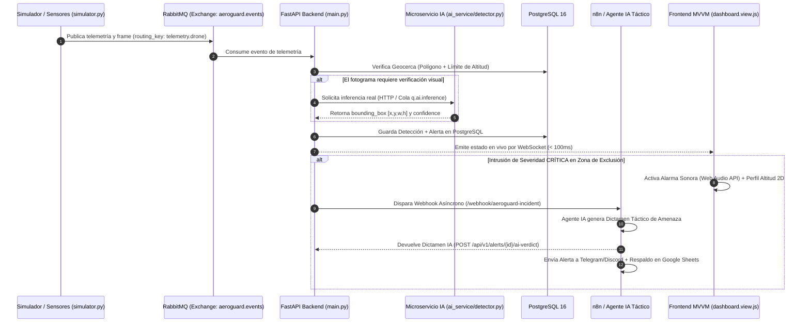

# DOCUMENTO MAESTRO DE PLANIFICACIÓN E INGENIERÍA DE REQUISITOS — AEROGUARD v1.1.0
**Fase:** 1 - PLAN (Ciclo de Vida DevOps)  
**Estado:** APROBADO PARA IMPLEMENTACIÓN EN FASE CODE  
**Referencia:** [PLANIFICACIONMEJORA.md](file:///h:/UTS/NUEVAS%20TECNOLOGIAS/AeroguardClase/PLANIFICACIONMEJORA.md)

---

## 1. [PLAN-01] Historias de Usuario, Criterios Gherkin y Contratos de API (IA Real y Reportes)

### 1.1 Historias de Usuario
- **HU-01 (Inferencia IA Real):** Como operador C-UAS, quiero que el endpoint `backend/app/api/v1/endpoints/ai.py` analice fotogramas reales mediante `ai_service/detector.py` (OpenCV/YOLOv8), para obtener detecciones verídicas con coordenadas `bounding_box` y nivel de confianza real en lugar de `YOLO_v8_mock`.
- **HU-02 (Reportes Físicos con Firma Criptográfica):** Como analista de seguridad, quiero descargar reportes tácticos reales en `.pdf` (`ReportLab`) y `.xlsx` (`openpyxl`) desde `backend/app/api/v1/endpoints/reports.py` y `frontend/src/views/misc.views.js`, sellados con un hash SHA-256 para contar con evidencia auditable.
- **HU-03 (Alertas Sonoras, Altimetría y Automatización SOAR):** Como jefe de operaciones, quiero que ante una incursión crítica el Dashboard emita una sirena táctica (Web Audio API), muestre el perfil de altitud 2D y dispare un flujo SOAR hacia n8n/Agente IA para generar un dictamen táctico automático.

### 1.2 Criterios de Aceptación (Gherkin)

```gherkin
[Escenario 1: Inferencia de Visión Artificial Real en Endpoint de IA (HU-01)]
Dado que el microservicio ai_service (detector.py) se encuentra activo
Cuando el operador envía una imagen JPEG/PNG válida a POST /api/v1/ai/analyze
Entonces el backend procesa la imagen real sin usar el mock estático
Y responde con código HTTP 200 en menos de 1500 ms
Y el JSON incluye "is_drone" (booleano), "confidence" (float 0.0 a 1.0) y "bounding_box" (x_min, y_min, width, height)

[Escenario 2: Archivo inválido enviado al analizador (HU-01)]
Dado que un usuario intenta analizar un archivo que no es imagen
Cuando envía el payload a POST /api/v1/ai/analyze
Entonces el sistema rechaza la petición con código HTTP 400 (Bad Request)
Y devuelve un mensaje indicando los formatos permitidos (JPEG, PNG, WEBP)

[Escenario 3: Descarga de reporte táctico en PDF con hash SHA-256 (HU-02)]
Dado que el usuario tiene rol "Admin" o "Analista" y existen detecciones registradas
Cuando solicita GET /api/v1/reports/export/pdf
Entonces el backend compila un documento binario real con ReportLab
Y el PDF incluye membrete institucional UTS, estadísticas KPI, tabla de incursiones y hash SHA-256 al pie
Y devuelve Content-Type "application/pdf" descargando el archivo físico en el navegador

[Escenario 4: Exportación de telemetría histórica a Excel (HU-02)]
Dado que el usuario solicita exportar el historial desde la vista de Reportes
Cuando invoca GET /api/v1/reports/export/excel
Entonces el backend genera un libro real con OpenPyXL y descarga un archivo .xlsx válido
```

### 1.3 Contrato de API: `POST /api/v1/ai/analyze`
- **Request (`multipart/form-data`):**
  - `file`: Binary image (`.jpg`, `.jpeg`, `.png`, `.webp`)
  - `sensor_id`: `string` (ej. `"CAM-BGA-NORTE-01"`)
  - `zone_id`: `integer` (opcional)
- **Response (`200 OK - application/json`):**
```json
{
  "status": "success",
  "sensor_id": "CAM-BGA-NORTE-01",
  "timestamp": "2026-10-14T14:22:10Z",
  "engine": "YOLOv8n-OpenCV-Real",
  "detection": {
    "is_drone": true,
    "label": "quadcopter_uav",
    "confidence": 0.914,
    "bounding_box": {
      "x_min": 412,
      "y_min": 185,
      "width": 124,
      "height": 88
    },
    "threat_level": "CRITICAL"
  },
  "processing_time_ms": 84.5
}
```

### 1.4 Especificación de Plantilla del Reporte PDF (`ReportLab`)
1. **Cabecera Táctica:** Membrete "UTS - AeroGuard C-UAS", Fecha/Hora UTC de generación, ID único de reporte y usuario solicitante.
2. **Resumen Ejecutivo (KPIs):** Total de vuelos detectados, violaciones de geocerca, altitud máxima registrada y sensor con mayor actividad.
3. **Dictamen Táctico IA:** Párrafo con la evaluación táctica automática del último incidente crítico.
4. **Tabla Detallada de Incursiones:** Columnas: `ID Dron | Zona | Coordenadas (Lat, Lon) | Altitud (m) | Velocidad (m/s) | Severidad | Fecha/Hora`.
5. **Pie de Página Criptográfico:** Hash `SHA-256` calculado sobre la serialización de los datos del reporte para garantizar integridad y cadena de custodia.

---

## 2. [PLAN-02] Diseño de Arquitectura Asíncrona (RabbitMQ + IA + Base de Datos)

### 2.1 Diagrama de Secuencia del Flujo de Datos (Mermaid)


### 2.2 Topología de Colas en RabbitMQ
- **Exchange Principal:** `aeroguard.events` (Tipo: `topic`, `durable: true`)
- **Cola 1 (`q.telemetry.ingest`):** Recibe coordenadas emitidas por `simulator.py`. Routing key: `telemetry.#`.
- **Cola 2 (`q.ai.inference`):** Cola para procesamiento asíncrono de imágenes en `detector.py`. Routing key: `ai.frame.#`.
- **Cola 3 (`q.alerts.critical`):** Recibe violaciones de perímetro en Bogotá y Bucaramanga para disparar automatizaciones SOAR. Routing key: `alert.critical`.

---

## 3. [PLAN-03] Especificación de Interfaz Táctica 2.0, Altimetría y Alertas Sonoras

### 3.1 Wireframe Estructural del Dashboard (`frontend/src/views/dashboard.view.js`)
```text
+-----------------------------------------------------------------------------------+
| AEROGUARD C-UAS | Estado WS: [ONLINE] | [AUDIO: ACTIVO / MUTE] | Rol: Operador    |
+---------------------------------------------------+-------------------------------+
|                                                   | DICTAMEN AGENTE IA (NUEVO)    |
|                                                   | "UAV-402 mantiene rumbo norte |
|                                                   |  a 145m (supera techo de 120m)|
|           MAPA TÁCTICO INTERACTIVO                |  hacia Zona Crítica BGA.      |
|         (Leaflet.js + Geocercas Activas)          |  Acción: Iniciando bloqueo."  |
|                                                   +-------------------------------+
|     [Polígono Rojo: Zona Restringida BGA]         | PERFIL DE ALTITUD 2D (NUEVO)  |
|                UAV-402 (Crítico)                  | 200m |                        |
|                                                   | 150m |       * UAV-402 (145m) |
|                                                   | 120m |------- Techo Máx Zona -|
|                                                   |  50m |  * UAV-108 (45m)       |
|                                                   |   0m +----------------------- |
+---------------------------------------------------+-------------------------------+
```

### 3.2 Especificación Técnica de la Alarma Sonora (`Web Audio API`)
- **Implementación:** Síntesis nativa con `window.AudioContext` en `frontend/src/views/dashboard.view.js` (sin depender de archivos `.mp3` externos).
- **Condición de Disparo:** Se activa únicamente al recibir una alerta con `severity === "CRITICAL"` (o equivalente en incursión de geocerca).
- **Parámetros Acústicos (Sirena Táctica Bitonal):**
  - Tipo de oscilador: `sawtooth` o `square`.
  - Control de volumen (`GainNode`): `0.15` para evitar saturación.
  - Frecuencia alternante: `880 Hz` (220 ms) y `1320 Hz` (220 ms) en bucle mientras la alerta crítica esté activa y no silenciada.
- **Control en UI:** Botón `#btn-toggle-audio` en la barra superior del Dashboard que persiste el estado en `localStorage.getItem('aeroguard_audio_muted')`.

### 3.3 Especificación del Widget de Altimetría 2D
- Panel lateral o inferior en el Dashboard que grafica en tiempo real la altitud en metros (`0m` a `300m`) de los drones activos frente a una línea horizontal roja punteada que representa el techo máximo permitido de la zona (`120m`).

---

## 4. [PLAN-04] Diseño de Automatización SOAR (n8n) y Agente IA Táctico

### 4.1 Arquitectura del Flujo de Respuesta a Incidentes (SOAR)
1. **Disparador en Backend (FastAPI):** Cuando se registra una alerta crítica de geocerca, el backend ejecuta una petición asíncrona (`httpx.AsyncClient`) hacia el Webhook de n8n (o genera el dictamen localmente con fallback si n8n no está levantado).
2. **Orquestación en n8n (5 Nodos):**
   - `Nodo 1 (Webhook)`: `POST /webhook/aeroguard-incident` recibe la telemetría del incidente.
   - `Nodo 2 (AI Agent / LLM)`: Procesa los datos con el System Prompt táctico y redacta el dictamen.
   - `Nodo 3 (HTTP Callback)`: Envía el dictamen al backend para actualizar el Dashboard en tiempo real.
   - `Nodo 4 (Telegram / Discord)`: Envía notificación inmediata al canal de mando con coordenadas y dictamen.
   - `Nodo 5 (Google Sheets / Auditoría)`: Registra el incidente en una hoja externa como caja negra.

### 4.2 System Prompt para el Agente IA Analista Táctico
```text
Eres el Oficial de Inteligencia Artificial C-UAS del sistema AeroGuard.
Recibirás datos JSON de telemetría de un vehículo aéreo no tripulado (dron) detectado cerca o dentro de una zona de exclusión aérea en Colombia (Bucaramanga o Bogotá).

Tu tarea es generar un DICTAMEN TÁCTICO breve (máximo 3 oraciones, menos de 55 palabras) con tono militar profesional que incluya:
1. Evaluación del vector de amenaza (relación entre altitud actual, velocidad y la zona vulnerada).
2. Hipótesis de comportamiento (vuelo errático/recreativo vs. trayectoria directa/automatizada).
3. Recomendación operativa inmediata (monitoreo pasivo, alerta a patrulla perimetral o activación de inhibidor RF).
Responde únicamente con el dictamen, sin saludos ni preámbulos.
```

### 4.3 Contrato del Payload del Webhook (`FastAPI -> n8n`)
```json
{
  "event_type": "GEOFENCE_BREACH_CRITICAL",
  "incident_id": "INC-2026-0891",
  "timestamp": "2026-10-14T14:25:00Z",
  "drone": {
    "drone_id": "UAV-HK-402",
    "latitude": 7.1193,
    "longitude": -73.1227,
    "altitude_m": 145.0,
    "speed_ms": 19.4,
    "heading_deg": 182,
    "ai_confidence": 0.94
  },
  "zone": {
    "name": "Perímetro Seguridad UTS / Bucaramanga Centro",
    "max_allowed_altitude_m": 120.0,
    "restriction_type": "NO_FLY_ZONE"
  }
}
```

---

## 5. [CODE-06] Motor Geoespacial PostGIS y Algoritmo Ray-Casting 3D (RF-012, RF-017)

### 5.1 Arquitectura Dual de Cómputo Espacial
1. **Modo Producción (PostGIS / OGC Spatial):**
   - Extensión habilitada: `CREATE EXTENSION IF NOT EXISTS postgis;` en `backend/init.sql`.
   - Columna geométrica indexada con GiST: `geom GEOMETRY(Polygon, 4326)`.
   - Expresión de contención espacial: `ST_Contains(geom, ST_SetSRID(ST_MakePoint(:lng, :lat), 4326))`.
2. **Modo Embebido de Alta Frecuencia / Offline (Ray-Casting Jordan Curve):**
   - Servicio: `backend/app/services/geospatial_service.py`.
   - Algoritmo de cruce de rayos para polígonos cóncavos/convexos arbitrarios y cálculo ortodrómico Haversine para distancias perimetrales.
   - Verificación tridimensional estricta: `in_polygon_2d AND (min_altitude <= alt <= max_altitude)`.

### 5.2 Contrato de Endpoint: `POST /api/v1/zones/check-breach`
- **Request (`application/json`):**
```json
{
  "latitude": 7.1240,
  "longitude": -73.1750,
  "altitude": 150.0,
  "zone_id": "optional-uuid"
}
```
- **Response (`200 OK`):**
```json
{
  "is_breach": true,
  "breaches_count": 1,
  "evaluated_position": {
    "latitude": 7.124,
    "longitude": -73.175,
    "altitude": 150.0
  },
  "highest_breach": {
    "zone_id": "a5acfb37-ab3d-49bf-93f8-82d9589444b6",
    "zone_name": "Aeropuerto Palonegro (Área Crítica)",
    "threat_level": "critical",
    "in_polygon_2d": true,
    "in_altitude_range": true,
    "is_breached": true,
    "min_altitude": 0.0,
    "max_altitude": 1200.0,
    "current_altitude": 150.0,
    "distance_to_boundary_m": 820.37
  },
  "postgis_point_wkt": "POINT(-73.175 7.124)",
  "message": "Alerta: Incursión detectada en 1 zona(s) protegida(s)."
}
```

---

## 6. [BUILD-01] Optimización de Dockerfiles con Compilación Multi-Stage (DevOps - Fase Build)

### 6.1 Objetivos y Arquitectura de Compilación
1. **Reducción de Superficie de Ataque:** Eliminación de compiladores (`gcc`, `g++`, `build-essential`), paquetes de desarrollo (`libpq-dev`) y herramientas innecesarias en imágenes finales de producción.
2. **Optimización de Capas y Almacenamiento:** Reducción drástica del tamaño de las imágenes aprovechando imágenes base slim/alpine y compilación de dependencias en un virtualenv exportable (`/opt/venv`).
3. **Quality Gate en Build (CI/CD Ready):** Integración de un target `test` en el `backend/Dockerfile` que ejecuta el suite completo de pruebas unitarias (`pytest`) antes de publicar o desplegar la imagen runtime.
4. **Seguridad y Privilegios Mínimos:** Creación del usuario sin privilegios `aeroguard` (UID 1000) en todos los servicios en ejecución (`backend`, `ai_service`, `sensor_simulator`).
5. **Pre-Compresión de Activos en Frontend:** Uso de un stage `assets` basado en Alpine para generar variantes `.gz` estáticas (`gzip -9 -k -n`) y configuración de Nginx con directiva `gzip_static on;` para entrega web de latencia ultra baja sin sobrecarga de CPU en tiempo de ejecución.
6. **Healthchecks Autónomos y Livianos:** Implementación de verificaciones de estado con la librería estándar de Python (`urllib.request`) y utilidades nativas (`wget -q --spider`) eliminando la necesidad de empaquetar `curl`.

### 6.2 Matriz de Servicios y Estrategia Multi-Stage

| Servicio | Contexto / Dockerfile | Stages Implementados | Usuario | Base Runtime | Healthcheck |
| :--- | :--- | :--- | :--- | :--- | :--- |
| **Backend** | `./backend/Dockerfile` | `builder` → `test` → `runtime` | `aeroguard (1000)` | `python:3.11-slim` | Python stdlib (`urllib.request`) |
| **Frontend** | `./frontend/Dockerfile` | `assets` → `runtime` | `nginx` | `nginx:1.27-alpine` | `wget -q --spider` |
| **AI Service** | `./ai_service/Dockerfile` | `builder` → `runtime` | `aeroguard (1000)` | `python:3.11-slim` | Pasivo por cola RabbitMQ |
| **Simulator** | `./sensor_simulator/Dockerfile` | `builder` → `runtime` | `aeroguard (1000)` | `python:3.11-slim` | Pasivo continuo |

### 6.3 Políticas de Exclusión (.dockerignore)
Se configuraron archivos `.dockerignore` específicos por componente (`backend/.dockerignore`, `ai_service/.dockerignore`, `sensor_simulator/.dockerignore`, y la raíz `/.dockerignore`) que omiten:
- Entornos virtuales locales (`.venv`, `venv`, `env`).
- Archivos de caché de bytecode (`__pycache__`, `*.pyc`).
- Artefactos de pruebas y cobertura (`.pytest_cache`, `.coverage`, `htmlcov`).
- Archivos de secretos y variables de entorno (`.env`, `.env.*`).
- Bases de datos locales SQLite (`*.db`, `*.sqlite`, `*.sqlite3`).
- Repositorios de control de versiones y metadatos (`.git`, `.github`, `.agents`).

### 6.4 Configuración Orquestada (`docker-compose.yml`)
El archivo maestro `docker-compose.yml` fue alineado a la especificación estándar v3+:
- Cada servicio que construye desde código fuente especifica explícitamente `target: runtime` y tag semántico de imagen (`aeroguard/<service>:latest`).
- Declaración de dependencias condicionadas a estados de salud (`condition: service_healthy`) entre PostgreSQL, RabbitMQ, Backend y Simulador.
- Separación de volúmenes persistentes (`postgres_data`, `rabbitmq_data`, `reports_data`) e aislamiento en red puente dedicada `aeroguard_network`.

---

## 7. [BUILD-02] Validación de Sintaxis y Linters de Código (Python & JavaScript)

### 7.1 Objetivos de Calidad y Puertas de Verificación (Quality Gates)
1. **Validación Sintáctica Universal (Zero-Dependency):**
   - **Python:** Verificación estricta mediante `py_compile` en `scripts/check_python_syntax.py`, auditando recursivamente los 43 archivos `.py` (`backend/`, `ai_service/`, `sensor_simulator/`) y fallando inmediatamente ante errores de indentación o sintaxis.
   - **JavaScript:** Verificación estricta mediante el motor V8 nativo (`node --check`) en `scripts/check_js_syntax.js`, auditando los 15 módulos ES del SPA (`frontend/src/`) sin requerir descargas pesadas de paquetes npm.
2. **Estandarización de Linters en Python:**
   - Adopción de `pyproject.toml` como archivo de configuración estándar unificado con soporte para `ruff` (linter ultrarrápido) y `pytest`.
   - Compatibilidad retroactiva con `.flake8` para entornos tradicionales o extensiones IDE locales.
   - Reglas activas: `E` (pycodestyle errors), `W` (pycodestyle warnings), `F` (Pyflakes), `I` (isort), `B` (flake8-bugbear), `C4` (comprehensions), `UP` (pyupgrade).
   - Longitud máxima de línea: 120 caracteres.
3. **Estandarización de Linters y Formato en JavaScript:**
   - Soporte dual ESLint: `eslint.config.js` (Flat config moderno para ESLint 9+) y `.eslintrc.json` (para ESLint 8 y plugins de VSCode).
   - Variables globales reconocidas: APIs estándar de navegador (`window`, `document`, `WebSocket`, `AudioContext`), mapa Leaflet (`L`) y configuración de entorno (`AEROGUARD_*`).
   - Configuración de formateo con `.prettierrc.json` y `.prettierignore` (tabulación a 2 espacios, comillas simples, punto y coma obligatorio).
4. **Orquestación Centralizada en `package.json`:**
   - `npm run check:syntax:py`: Valida sintaxis Python.
   - `npm run check:syntax:js`: Valida sintaxis JavaScript.
   - `npm run check:syntax`: Ejecuta la verificación combinada de ambos lenguajes.
   - `npm run lint:js`: Ejecuta ESLint sobre el frontend.
   - `npm run lint:py`: Ejecuta Ruff sobre los microservicios Python.
   - `npm run format:check`: Audita conformidad visual con Prettier.
   - `npm run test:backend`: Dispara la batería completa de tests unitarios backend.
5. **Automatización Multi-Plataforma y Pre-Commit:**
   - Script PowerShell para Windows: `scripts/lint.ps1`.
   - Script Bash para Linux/CI: `scripts/lint.sh`.
   - Archivo `.pre-commit-config.yaml` que enlaza hooks de whitespace, fin de archivo, YAML/JSON, Ruff y chequeo local de sintaxis.
6. **Integración en Docker:**
   - En `backend/Dockerfile` (stage `test`), se ejecuta `python -m compileall app/ -q` previo al suite `pytest`, garantizando que ninguna imagen con errores de sintaxis pueda publicarse.

