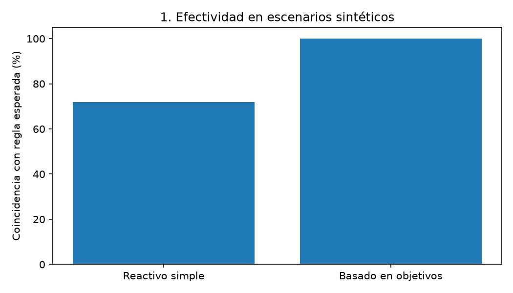
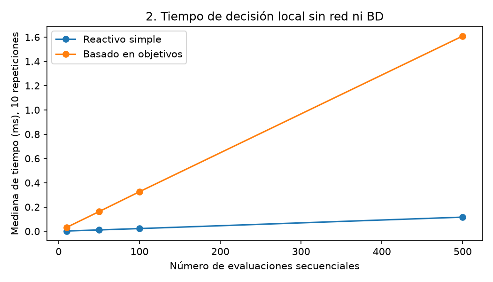
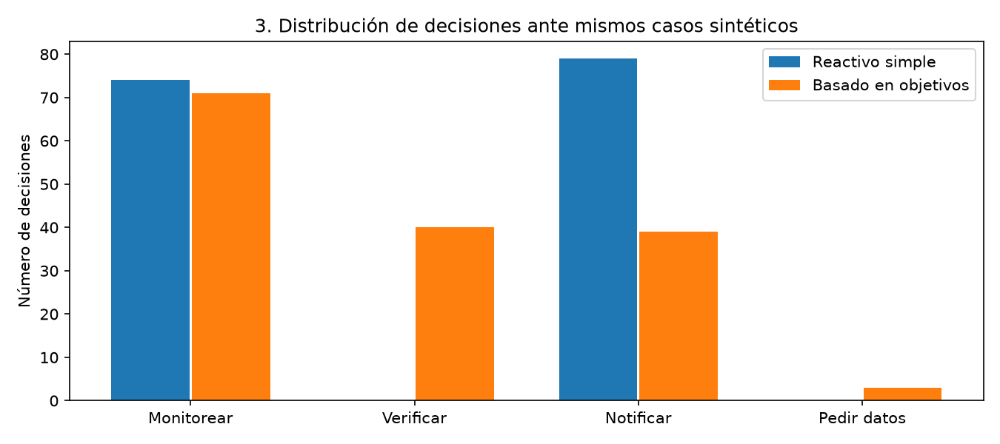

# AeroGuard — Aplicación de UN agente basado en objetivos

**Entrega de clase.** Se escogió **un solo modelo**, el **agente basado en objetivos** mostrado en las diapositivas. El agente reactivo simple es únicamente una referencia matemática del experimento, **no** un segundo agente instalado en el sistema.

> **Nota de rigor:** esto es un prototipo académico que recomienda acciones sobre telemetría de ejemplo. No comprueba que un objeto sea un dron ni determina intenciones, licencias, permisos o riesgo real.

## 1. Relación con las diapositivas del profesor

En clase se definieron los **agentes de software** como componentes capaces de actuar de forma autónoma o semiautónoma para alcanzar objetivos e interactuar con otros sistemas. También se describieron sus características y aplicaciones.

| Concepto explicado en clase | Evidencia en AeroGuard |
|---|---|
| **Autonomía** | El servicio evalúa cada incidente recibido y propone una acción sin pedirle al operador que elija manualmente la regla. |
| **Percepción** | Recibe altitud, umbral de altitud, velocidad y confianza visual declarada; valida que la información sea utilizable. |
| **Toma de decisiones** | Selecciona una de cuatro acciones a partir de objetivos y datos del incidente. |
| **Ejecución de acciones** | Retorna una recomendación informativa, su prioridad y sus evidencias; el operador debe verificarla. No ejecuta intervenciones físicas. |
| **Inteligencia** | En este proyecto es razonamiento determinista basado en reglas orientadas a objetivos; no es aprendizaje automático. |
| **Interacción** | Su decisión se comunica por API y, en el recorrido operativo, también por WebSocket hacia el Dashboard. |
| **Proactividad** | El servicio propone revisar cuando detecta la condición de interés. En la versión estudiantil la evaluación se invoca desde un incidente, no monitorea todos los eventos por sí sola. |

Las diapositivas también mencionan reactivos, deliberativos, adaptativos, móviles, con modelo, de utilidad y de aprendizaje. **No se implementaron esos tipos por separado.** Nuestro objetivo es mostrar únicamente el comportamiento del agente basado en objetivos. Que aplique reglas no significa que realice planificación compleja, aprenda o sea móvil.

## 2. ¿Por qué escogimos este modelo?

AeroGuard no necesita limitarse a una respuesta fija de «superó umbral = amenaza». Para un sistema de monitoreo es más útil **distinguir entre vigilar, verificar una lectura, avisar para una revisión y solicitar datos válidos**. El agente orientado a objetivos admite decisiones trazables que se pueden explicar al profesor y al operador.

Se definieron cuatro objetivos:
1. Mantener vigilancia sobre eventos reportados.
2. Priorizar revisión de eventos que excedan el umbral configurado.
3. No elevar alarmas críticas cuando faltan evidencias suficientes.
4. Explicar cada recomendación con datos visibles.

**Decisiones posibles:**

| Condición | Acción | Prioridad |
|---|---|---|
| Altitud dentro de umbral con datos válidos | `MONITOREAR` | NORMAL |
| Altitud sobre umbral y confianza visual baja, ausente o inválida | `VERIFICAR_DETECCION` | REVIEW |
| Altitud sobre umbral y confianza visual no baja | `NOTIFICAR_Y_VERIFICAR` | CRITICAL |
| Altitud/umbral inválidos o ausentes | `SOLICITAR_DATOS` | INDETERMINATE |

Una prioridad **CRITICAL** es la prioridad de la **revisión humana** en este experimento; no representa una identificación confirmada del objeto ni una autorización para actuar sobre él.

## 3. ¿Cómo está aplicado en la aplicación web?

### Flujo operativo del agente

`POST /api/v1/alerts/trigger-incident` recibe un evento de telemetría válido. El servicio `ai_tactical_agent_service.py` llama a `evaluate_goals()`, genera un objeto `goal_decision` (acción, prioridad, objetivos, evidencia y explicación) y devuelve la respuesta por HTTP. Cuando está habilitada la orquestación externa n8n, conserva el dictamen de ese sistema y presenta la recomendación local separadamente; si no hay dictamen externo, la decisión local gobierna la severidad informativa. El servicio publica el evento `ai_verdict` por WebSocket y mantiene en memoria el último resultado accesible desde `GET /api/v1/alerts/ai-verdict`.

El **Dashboard** muestra qué recomendó el agente, su prioridad, la justificación y si exige revisión humana. La acción del modelo no equivale a la detección de un dron real ni crea por sí misma una fila permanente de alerta.

### Laboratorio de exposición en el Dashboard

El panel tiene un selector **Laboratorio: agente basado en objetivos** con tres escenarios:
- `critical`: 135 m frente a 120 m, confianza 0,95 → NOTIFICAR_Y_VERIFICAR.
- `review`: 135 m frente a 120 m, confianza 0,20 → VERIFICAR_DETECCION.
- `monitor`: 80 m frente a 120 m, confianza 0,90 → MONITOREAR.

El botón **Evaluar modelo** llama a `POST /api/v1/alerts/evaluate-goals` con la misma lógica de `evaluate_goals()`, pero **sin escribir en la base de datos, modificar el último dictamen real, activar sirenas, emitir WebSockets o contactar n8n**. El panel se identifica como **SIMULACIÓN ACADÉMICA**, para no confundir una evidencia de clase con una alarma operativa. Las rutas están protegidas por autenticación y permisos.

El botón operativo **Disparar SOAR** también se conserva para una detección vinculada a una zona activa; su flujo es distinto del laboratorio.

## 4. Gráfica 1: ¿Qué tan efectivo es el modelo?

**Definición de la medida:** porcentaje de acciones que coinciden con la decisión esperada según las reglas del experimento, en 153 casos sintéticos.

| Referencia experimental | Coincidencias | Porcentaje |
|---|---:|---:|
| Reactivo simple (comparador, no integrado como agente) | 110 / 153 | **71,9 %** |
| Basado en objetivos | 153 / 153 | **100,0 %** |

**Análisis:** la diferencia es **28,1 puntos porcentuales** y **43 casos**. El modelo elegido distingue condiciones que el comparador no maneja, especialmente confianza baja y telemetría inválida. **No es una medida de precisión de identificación de drones**: los resultados esperados fueron definidos con las mismas reglas que usa el modelo; este resultado comprueba consistencia, no capacidad de generalizar.

## 5. Gráfica 2: ¿Qué tan eficiente es?

Medianas de **10 repeticiones** de lotes de decisiones secuenciales, medidas en milisegundos:

| Cantidad de decisiones | Reactivo simple | Basado en objetivos |
|---:|---:|---:|
| 10 | 0,0025 ms | 0,0326 ms |
| 50 | 0,0115 ms | 0,1624 ms |
| 100 | 0,0226 ms | 0,3261 ms |
| 500 | 0,1167 ms | 1,6086 ms |

**Análisis:** el modelo basado en objetivos usa más procesamiento porque valida datos, decide entre más alternativas y produce evidencias. En el lote de **500 decisiones** utilizó aproximadamente **13,8 veces** el tiempo del comparador, pero ambos terminaron en pocos milisegundos en la máquina de medición. Los números son **tiempos de lotes locales**, no latencia por evento ni tiempos de la app completa. No incluyen consultas a BD, HTTP, WebSocket, red, carga concurrente ni sensores; no prueban cumplimiento de los requisitos de rendimiento del IEEE 830. Los tiempos se deben volver a medir en el equipo de exposición si se desean cifras de esa máquina.

## 6. Gráfica 3: ¿Cómo cambia la toma de decisiones?

| Acción | Reactivo simple | Basado en objetivos |
|---|---:|---:|
| MONITOREAR | 74 | 71 |
| VERIFICAR_DETECCION | 0 | 40 |
| NOTIFICAR_Y_VERIFICAR | 79 | 39 |
| SOLICITAR_DATOS | 0 | 3 |
| **Total** | **153** | **153** |

**Análisis:** el reactivo simple solo puede monitorear o notificar: dio 79 notificaciones. El modelo elegido conservó 39 notificaciones, pidió verificar 40 casos por baja confianza y solicitó datos en 3 casos inválidos. Esto muestra **decisiones más diferenciadas** bajo las reglas seleccionadas; no demuestra por sí solo que reduzca falsas alarmas reales, porque no contamos con etiquetas de campo independientes.

## 7. Demostración breve al profesor

1. Iniciar AeroGuard con `scripts/expo_local.py` y entrar al Dashboard.
2. Explicar en una frase qué es un agente y por qué se escogió el **basado en objetivos**.
3. En el laboratorio, seleccionar **Umbral superado · confianza alta** y pulsar **Evaluar modelo**. Leer la acción, prioridad y evidencias.
4. Cambiar a **confianza baja** y repetir; señalar que, con la misma altitud, ahora recomienda **verificación**.
5. Seleccionar **Dentro del umbral** para mostrar **MONITOREAR**.
6. Aclarar que son datos sintéticos, sin falsas alertas operativas.
7. Mostrar las **tres gráficas**, explicando efectividad, coste de procesamiento y distribución.
8. Explicar límites: es una regla orientada a objetivos; no aprende, no identifica drones reales, no interpreta intenciones y no realiza acciones físicas.

### Preguntas probables y respuestas

**¿Por qué no un agente reactivo?** El reactivo simple es rápido, pero no distingue confianza baja o datos inválidos en nuestra comparación. Necesitamos recomendaciones justificadas.

**¿El 100 % significa que detecta todos los drones?** No; es concordancia con reglas esperadas en ejemplos sintéticos.

**¿Por qué tarda más?** Evalúa condiciones adicionales y prepara evidencia para justificar la decisión.

**¿Cómo se aplica en AeroGuard?** El servicio recibe un incidente, evalúa las metas, emite una recomendación y la comunica por API/WebSocket. El Dashboard la muestra; el laboratorio permite repetir los tres escenarios sin afectar alertas reales.

**¿Se implementaron todos los agentes de la diapositiva?** No. **Uno: basado en objetivos**. El reactivo simple únicamente sirve como comparador experimental.

## 8. Qué está probado y qué no

- Pruebas unitarias de objetivos, pruebas HTTP y evaluación reproducible sobre casos sintéticos.
- Pruebas aisladas con Chromium/Playwright para la interfaz y el flujo de muestra, ejecutadas en GitHub Actions.
- Pendiente fuera del alcance: validación con sensores físicos y detección visual independiente de drones; evaluación con usuarios reales y despliegue productivo específico de este modelo.
- El modelo no reemplaza automáticamente la lógica de geocercas, registro de detecciones y alertas persistentes de otros módulos. Es una **capa de decisión informativa del análisis táctico**, más un laboratorio seguro de clase.

**Código:** `backend/app/services/goal_based_agent.py`. **Evaluación reproducible:** `python scripts/evaluar_agente_objetivos.py`. **Datos:** `resultados/casos_sinteticos.csv` y `resultados/metricas.json`.
