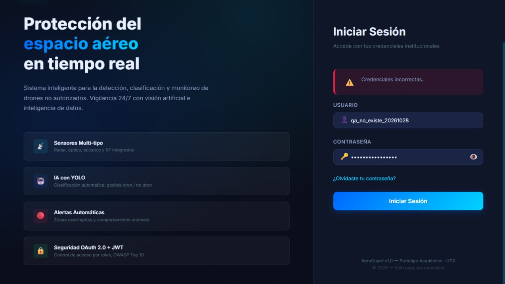
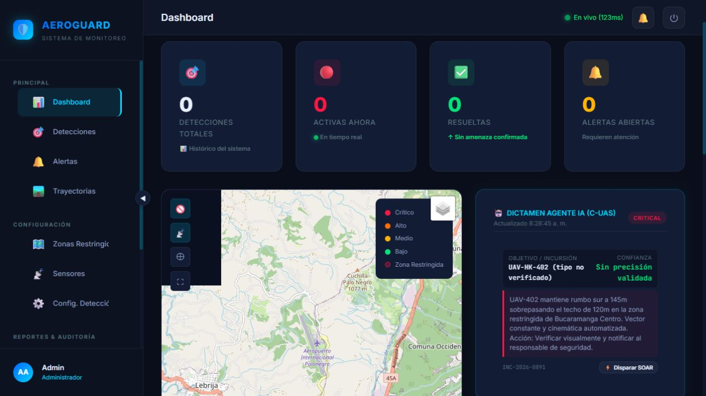
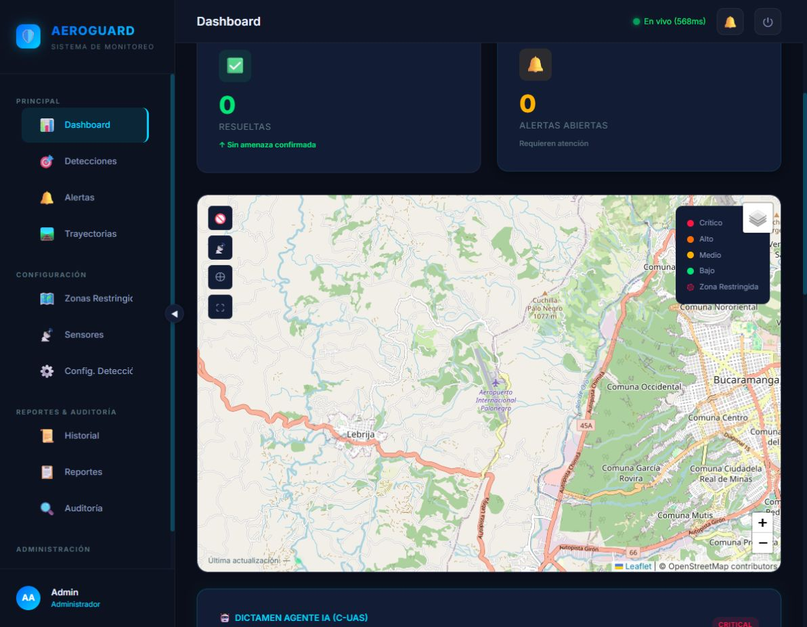
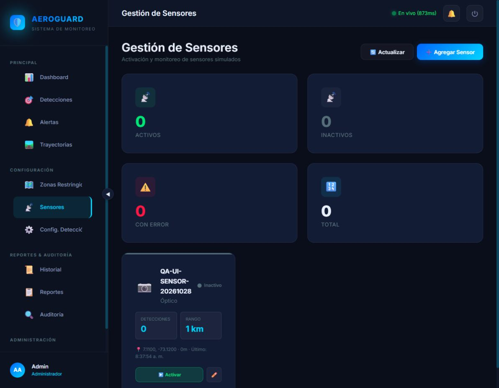
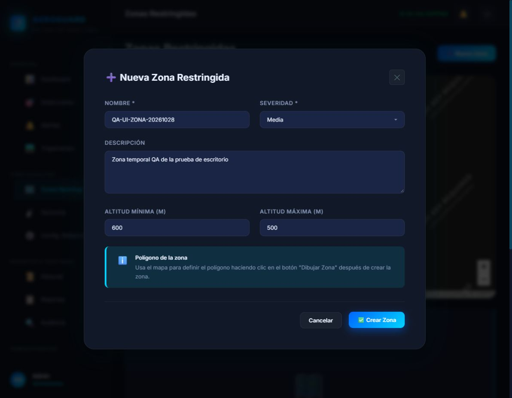
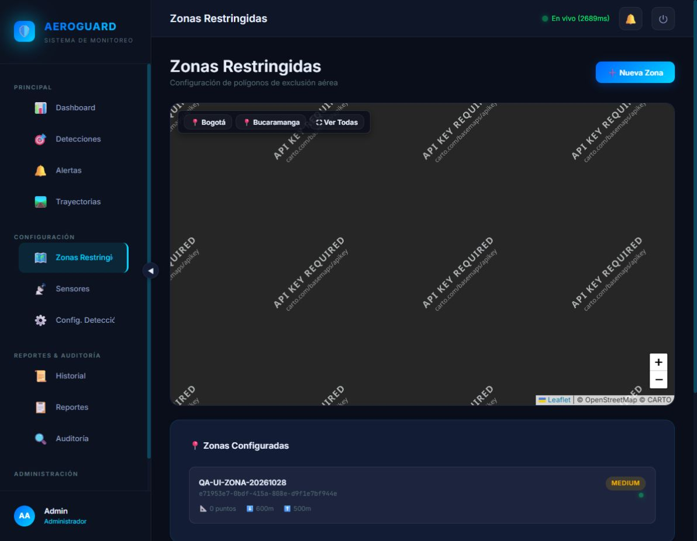
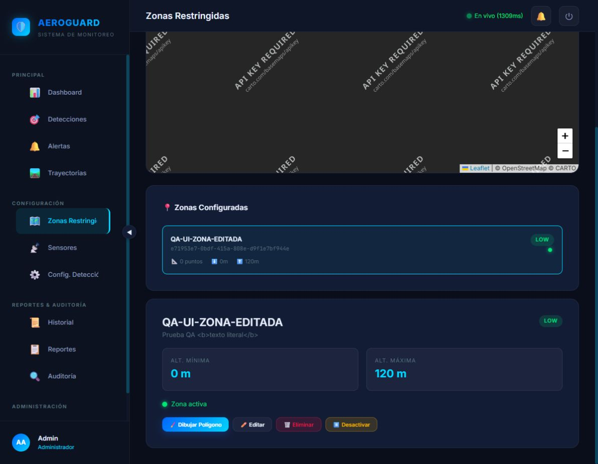
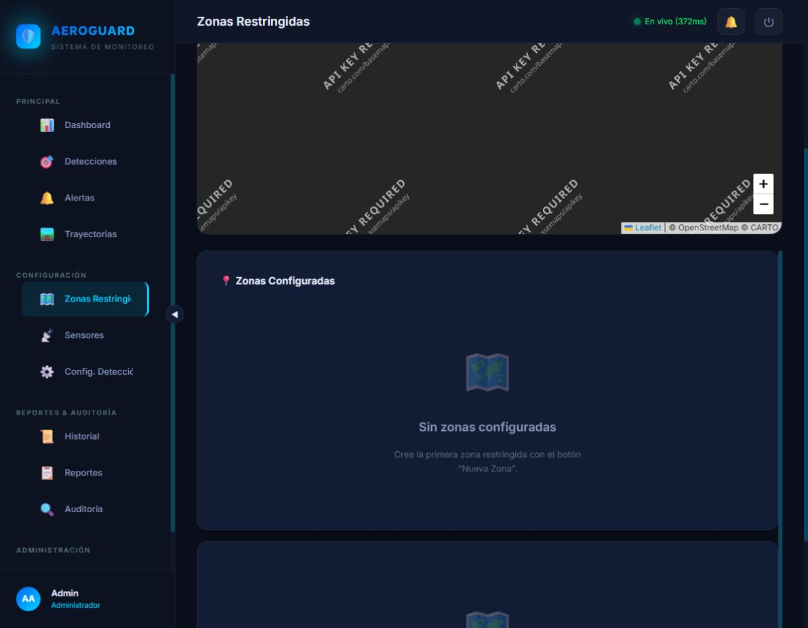
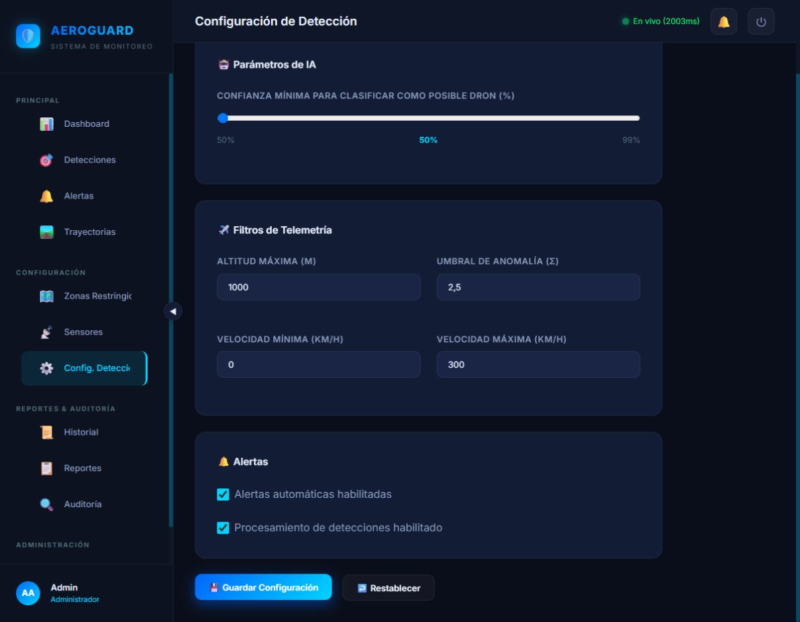

# Revisión parcial de interfaz de AeroGuard — 28 de octubre de 2026

Estado: pausada por solicitud del usuario para continuar desde la universidad. No es una certificación completa y los fallos siguen pendientes de corrección.

Se revisó la versión publicada 1.2.0-rc.1 en una instalación de QA separada, con base y volúmenes propios. Solo se comprobó el formulario vacío de acceso en la instalación principal. Las demás operaciones se realizaron en QA con datos sintéticos. El código de referencia local antes de este cierre es b72b4db; las imágenes desplegadas corresponden a 33f1cfd.

## Resultados registrados

50 casos: 29 aprobado, 16 fallo, 5 observacion. Los cuatro fallos SENSOR-LIMITE corresponden a restricciones del cliente HTML; la API rechazó los valores inválidos.

El detalle caso por caso está en [casos.json](casos.json). Las observaciones requieren comprobación adicional.

## Fallos para atender al retomar

- Configuración: Guardar y Restablecer fallan al acceder a un checkbox inexistente. En `frontend/src/views/misc.views.js` se renderiza `conf-processing-enabled` pero se consulta `conf-ai-enabled`.
- Dashboard: aparece un incidente crítico de ejemplo sin detecciones. SOAR permite procesar datos de ejemplo como incidente. Probar Sirena estando silenciado llama `Toast.warning`, aunque la utilidad ofrece `warn`.
- Sensores: editar un sensor activo lo vuelve inactivo. Los contadores no se refrescan automáticamente después de crear o activar; Actualizar manual sí los corrige. Faltan límites HTML en cuatro campos, aunque el backend rechaza sus valores inválidos.
- Zonas: se aceptó altitud mínima mayor que máxima. El mapa de zonas mostró API KEY REQUIRED. La zona puede quedar activa sin vértices; completar la validación de ese caso.
- Usuarios: un error del backend cierra el formulario de alta y pierde lo escrito.
- Otros: Perfil no respondió y el pie del login muestra v1.0. Revisar el atributo accesible del botón de colapsar y la recuperación de contraseña.

No se aplicaron arreglos a estos hallazgos durante esta revisión. Las referencias al código son observaciones estáticas que acompañan las reproducciones en interfaz.

## Evidencias

## Punto de continuación

Se quedó abierto el modal Editar Usuario de QA UI Operador. No se guardaron cambios en ese modal. Falta probar edición y estados de usuarios, permisos por rol, detecciones, alertas, trayectorias, reportes, historial, auditoría y recorridos entre módulos. Recuperación de contraseña y servicios externos siguen pendientes.

Se conservaron el operador `qa_ui_operador_20261028` y el sensor `QA-UI-SENSOR-EDITADO`, actualmente inactivo. La zona temporal `QA-UI-ZONA-EDITADA` fue eliminada con autorización expresa. No eliminar otros datos por esa autorización.

Al pausar se detuvieron únicamente los cuatro contenedores del proyecto `aeroguard-qa20261028`, conservando los volúmenes, y se cerró su túnel local 18082. La instalación principal mantuvo sus cuatro servicios saludables al comprobarla en ese momento. Estos datos describen el cierre y deben consultarse nuevamente al retomar.

Las credenciales quedan exclusivamente en el servidor, fuera de Git. Consultar el archivo de continuación de la raíz para las rutas privadas y los pasos de reanudación. No copiar claves privadas entre computadores ni reutilizar contraseñas de demostración.
