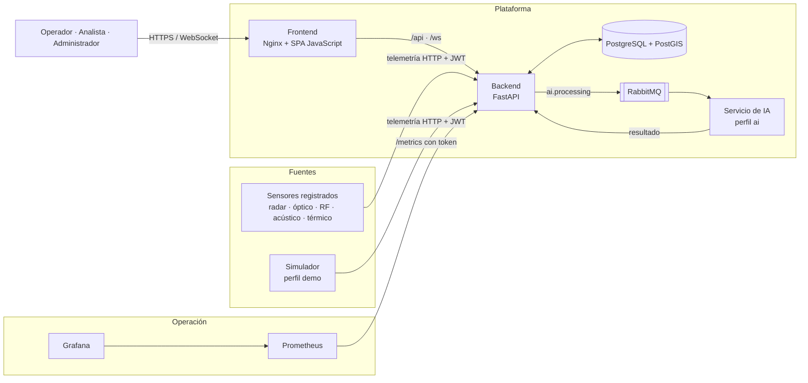

# AeroGuard — Arquitectura técnica

Versión: 10-11-2026 · Código `1.2.0-rc.2`. Describe la arquitectura **tal como está implementada hoy**. El diseño original de la versión 1.1.0 se conserva en [PLANIFICACION_V1.1.md](../PLANIFICACION_V1.1.md).

## 1. Propósito del sistema

Recibir observaciones de objetos aéreos desde sensores registrados, convertirlas en detecciones con trayectoria, comprobar si invaden zonas restringidas, alertar en tiempo real a un operador humano y conservar evidencia auditable de lo ocurrido.

## 2. Vista general



## 3. Componentes

| Componente | Tecnología | Responsabilidad | Ubicación |
|---|---|---|---|
| Frontend | JavaScript nativo (módulos ES), Leaflet, Nginx | Consola web de una sola página; mapas; alertas sonoras; proxy de API y WebSocket | `frontend/`, `nginx.conf` |
| Backend | Python 3.11, FastAPI, SQLAlchemy asíncrono | API REST, WebSocket, reglas de negocio, permisos, reportes, auditoría, programador de reportes | `backend/app/` |
| Base de datos | PostgreSQL 16 + PostGIS 3.5 | Persistencia y consultas espaciales con índice GiST | `backend/init.sql` |
| Mensajería | RabbitMQ 3.13 | Cola `ai.processing` y cola de mensajes rechazados | `docker-compose.yml` |
| Servicio de IA | Python, OpenCV/Pillow; YOLO opcional | Análisis **experimental** de imágenes | `ai_service/` |
| Simulador | Python | Genera telemetría de ejemplo para demostraciones | `sensor_simulator/` |
| Monitoreo | Prometheus, Grafana | Métricas, reglas de alerta y tablero | `monitoring/` |
| Automatización | n8n (flujo de ejemplo) | Respuesta a incidentes; no probado con un servicio externo | `automation/n8n/` |

El servicio de IA y el simulador son perfiles opcionales de Docker Compose (`ai` y `demo`). El sistema básico funciona sin ellos.

## 4. Flujo principal: de la telemetría a la alerta

```mermaid
sequenceDiagram
    participant Sensor
    participant API as Backend
    participant DB as PostGIS
    participant WS as WebSocket
    participant UI as Consola
    Sensor->>API: POST /api/v1/sensors/telemetry
    API->>API: Valida rangos, permisos y umbrales configurados
    API->>DB: Busca el sensor (debe estar registrado y activo)
    API->>DB: Crea o actualiza la detección y añade punto de trayectoria
    API->>DB: ¿El punto está dentro de una zona restringida activa?
    alt Invasión y no hay alerta activa para ese objeto
        API->>DB: Crea la alerta
    end
    API->>WS: detection_new (y alert_new si aplica)
    WS->>UI: El mapa mueve el marcador; suena la sirena si es crítica
    UI->>API: El operador asigna y resuelve la alerta con justificación
    API->>DB: Registra la acción en la auditoría encadenada
```

Reglas relevantes del flujo:

- Un sensor desconocido se rechaza. Solo el modo de exposición local registra sensores automáticamente.
- Las observaciones del mismo `object_id` se asocian a una misma detección y acumulan su trayectoria.
- No se crean alertas duplicadas mientras exista una activa para el mismo objeto y zona.
- Si el WebSocket se cae, la consola consulta periódicamente la API y reintenta la conexión con espera creciente.

## 5. API

Prefijo `/api/v1`. Especificación completa en [AeroGuard_OpenAPI.json](../AeroGuard_OpenAPI.json) y, con el sistema en marcha, en `/docs`.

| Recurso | Ruta | Uso |
|---|---|---|
| Autenticación | `/auth` | Inicio y cierre de sesión, renovación de token, cambio y recuperación de contraseña, perfil |
| Usuarios | `/users` | Alta, consulta y activación de cuentas |
| Sensores | `/sensors` | Registro de sensores e ingesta de telemetría |
| Detecciones | `/detections` | Listado, detalle, estado, trayectoria y análisis de IA |
| Alertas | `/alerts` | Listado, asignación, resolución y dictamen táctico |
| Zonas | `/zones` | Zonas restringidas y verificación de invasión |
| Reportes | `/reports` | Generación, programación, exportación y descarga |
| Auditoría | `/audit` | Consulta y verificación de integridad de la cadena |
| Configuración | `/config` | Parámetros operativos |
| IA | `/ai` | Análisis de una imagen |
| Tiempo real | `/ws/live` | Canal WebSocket autenticado |
| Sistema | `/health`, `/ready`, `/metrics` | Estado, disponibilidad y métricas protegidas |

## 6. Modelo de datos

| Tabla | Contenido |
|---|---|
| `users` | Cuentas, rol y estado |
| `sensors` | Sensores con tipo, estado, posición y alcance |
| `sensor_tracks` | Asociación entre sensor, objeto observado y detección |
| `restricted_zones` | Polígonos con rango de altitud y geometría PostGIS |
| `detections` | Objeto detectado, posición, nivel de amenaza y estado |
| `trajectory_points` | Puntos históricos de cada detección |
| `alerts`, `alert_comments` | Alertas con severidad, estado, asignación y notas |
| `events` | Eventos del sistema |
| `audit_logs`, `audit_checkpoint` | Registro encadenado por hash y su punto de control |
| `reports`, `report_schedules` | Reportes generados con su hash y programaciones |
| `system_config` | Parámetros operativos persistidos |
| `auth_state`, `auth_attempts` | Sesiones revocadas, tokens de un solo uso y límite de intentos |

Valores principales:

- **Tipos de sensor:** radar, acústico, RF, óptico, térmico.
- **Estado de detección:** activa, pendiente, resuelta, descartada.
- **Nivel de amenaza y severidad:** bajo, medio, alto, crítico.
- **Estado de alerta:** abierta, asignada, resuelta, cerrada.
- **Formatos de reporte:** PDF, CSV, Excel.

## 7. Seguridad

| Control | Implementación |
|---|---|
| Autenticación | JWT con expiración, renovación y revocación persistente; contraseñas con bcrypt |
| Autorización | Permisos por rol comprobados en cada ruta ([matriz en el manual](MANUAL_DE_USUARIO.md)) |
| Abuso de credenciales | Límite de intentos por ventana de tiempo; recuperación de contraseña de un solo uso |
| Transporte y navegador | Cabeceras de seguridad y política de contenido (CSP) en Nginx |
| Producción | Rechaza la clave de ejemplo, el modo depuración, los datos de demostración y el respaldo a SQLite |
| Integridad | Reportes con SHA-256 verificado al descargar; auditoría encadenada verificable |
| Métricas | `/metrics` exige un token propio que no da acceso a la API |
| Secretos | Fuera del repositorio, en `.env` o en archivos de secretos generados localmente |
| Análisis estático | Bandit y auditoría de dependencias en la integración continua |

Pendientes de seguridad conocidos: identidad criptográfica por sensor, anclaje externo de la auditoría y pruebas de penetración independientes.

## 8. Despliegue

| Entorno | Cómo | Para qué |
|---|---|---|
| Exposición local | `scripts/expo_local.py` con SQLite y datos de ejemplo | Demostraciones y desarrollo |
| Docker Compose | `docker-compose.yml` con PostgreSQL y RabbitMQ | Entorno completo en un equipo |
| Servidor privado | `deploy/` con imágenes fijadas por digest, Docker sin privilegios y acceso por túnel SSH | Instalación verificada de la candidata `1.2.0-rc.1` |

Instrucciones en el [README](../../README.md), el [paquete de despliegue](../../deploy/README.md) y el [manual de operación](../correcciones-2026-10-21/OPERACION.md).

## 9. Calidad

- **Integración continua:** GitHub Actions ejecuta sintaxis, pruebas de backend y frontend, auditoría de dependencias, ensayo de despliegue y pruebas de navegador.
- **Pruebas:** 167 de backend y 11 de frontend (10-11-2026); 51 casos de navegador con Playwright; pruebas de carga de WebSocket.
- **Versionado:** SemVer con candidatas, descrito en [VERSIONING.md](../../VERSIONING.md).

## 10. Límites de la arquitectura actual

- No hay adaptadores para equipos físicos: la única entrada es el paquete de telemetría HTTP.
- No hay fusión de varios sensores ni seguimiento avanzado; la asociación se basa en el identificador del objeto.
- La visión artificial es experimental y no tiene métricas de campo.
- La visualización es en dos dimensiones.
- Una sola instancia de backend; no se ha probado el escalado horizontal.
